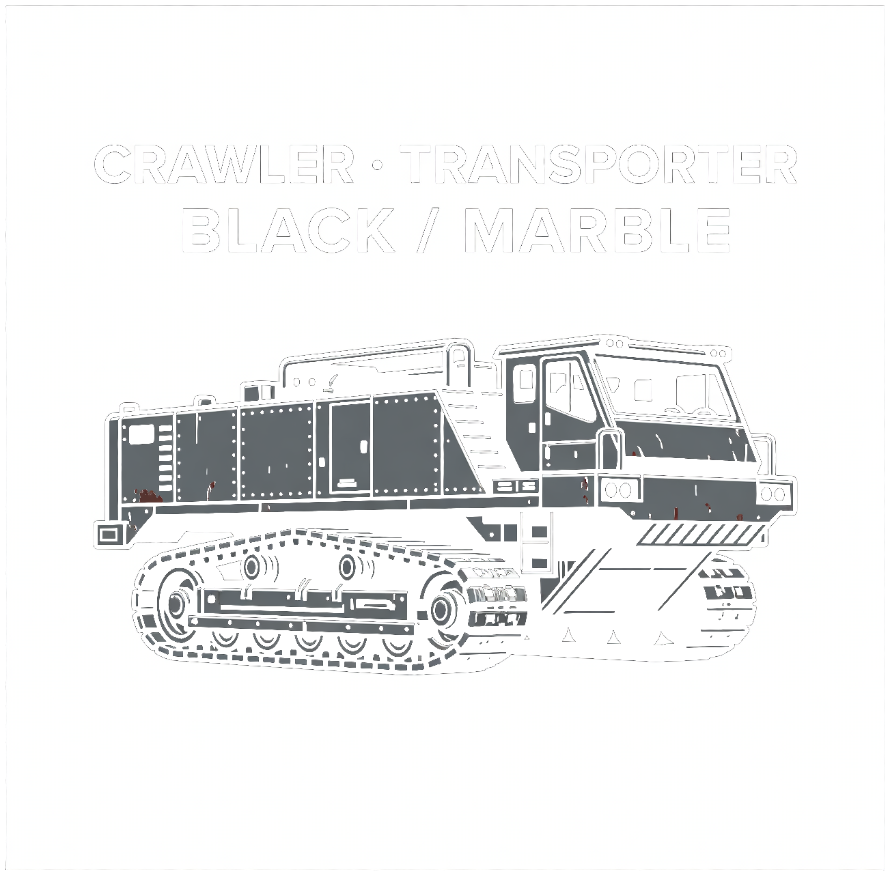

# Crawler transporter



The sheet is a product card: **CRAWLER · TRANSPORTER**, colorway **BLACK / MARBLE**. The red flecks are the print. The machine is black.

It reads as a two-crew tracked carrier. A person climbs the ladder, opens a side hatch, and sits in the cab. That sets the size. The drawing's vehicle box is 1031 by 499 pixels, so a 6600 mm length gives a 3194 mm height, ground to the cab-roof lamps.

The CAD is in STEVE, revision 2: [Crawler transporter](https://stevecad.studio/?document=d05183c9-e4ee-4852-b4c3-71879d479f8e). Fit check at rest and with both hatches open: clear, 210 pairs.

## Reading the image

Cab to the right, which is forward. X forward, Y to the left, Z up. Origin on the ground, mid-length.

| On the sheet | Read as | In the model |
|---|---|---|
| Long riveted body | Plate hull sitting on the tracks | 16 mm 6061 shell, 5800 mm of hull, full 2460 mm width |
| Cab, glass, three roof lamps | Two-crew cab | Box cab, windshield, side glass, three lamps. Lamp tops at 3184 mm |
| Bumper ahead of the tracks | Nose | Bumper at 1640–1920 mm, out to 3300 mm |
| Dark band under the body | Continuous tracks | One rigid shoe band per side, 420 mm wide, 70 mm thick |
| Large rear wheel with a hub | Drive sprocket | Rear sprocket, ten lugs as the tooth envelope, pitch radius 635 mm |
| Large front wheel | Idler | Front idler, the shoe wraps it |
| Row of smaller wheels | Road wheels | Six per side, on the inner face of the bottom shoe |
| Door with a window | Side hatch | Both sides, hinged on the forward edge, 70° out |
| Ladder by the cab | Boarding ladder | Left side, the side the sheet shows |
| Rail and the raised box on the deck | Deck rail and a cooling plenum | Rail both sides. Plenum opens into the bay |
| Small square aft | Port | Glazed port each side of the rear bay |
| Rear stub | Step | Step behind the hull, above the track |

The keel between the tracks is not on the sheet. The tracks hide it. It is a 16 mm box from 480 mm off the ground up into the floor, and it carries the final drives.

## What it does not reuse

The [joint actuator](../unknown-machine/) is a 2 N·m module. Rolling this machine on firm ground takes about 3600 N·m at each sprocket. The crawler is a different size class. The motors are the two final-drive housings, one at each rear sprocket, with an 80:1 reduction taken at 0.90. That ratio is a choice, not a cut gearbox.

`requirements/motor.toml` at 3342 rpm on a 700 V bus:

```
FAIL   KBM-17H01-A00     cont 2.08 N·m, peak 5.95
FAIL   KBM-17H01-B00     cont 2.06 N·m, peak 6.14
FAIL   KBM-17H01-C00     cont 2.07 N·m, peak 6.35
FAIL   KBM-17H02-C00     cont 3.57 N·m, peak 12.7
FAIL   ILM 85x13         cont 1.44 N·m, peak 4.66
```

Every card meets the bus. None of them is within an order of magnitude of the torque. The parts library has no traction motor for this machine.

## How it moves

The shoe band is one solid. A closed chain of links is not a joint tree, so the band stays still and the wheels turn inside it, geared to the pitch line. The road-wheel arms are fixed at ride height. The band does not deflect, so the wheels do not travel.

`roll` turns both sprockets together. One turn is 4.0 m along the ground. The `crawl` animation is one turn in 8 s. `skid` turns the two sides opposite ways, ±40° at the sprocket, which is a short pivot. `board` opens both hatches.

## Main numbers

From `analysis/hand_calcs.py`, which prints:

```
cad mass        15409.5 kg
operating mass  16389.5 kg   (cad 15409.5 + cells 800 + crew 180)
pitch radius    0.635 m    contact 4.336 m x 0.42 m, both tracks
ground pressure 44.1 kPa
com height      1.330 m    static tip 42.8 deg about the outer shoe edge

cruise          10.0 km/h    sprocket 41.8 rpm    motor 3342 rpm at 80:1
firm, Crr 0.07   force 11255 N    motor 49.6 N·m each    power 31.3 kW
soft, Crr 0.15   force 24117 N    motor 106.4 N·m each
firm + 10% grade   sprocket 8678 N·m    motor 120.5 N·m each

cells 800 kg at 160 Wh/kg is 128 kWh
at 31.3 kW that is 4.1 h, 41 km, before other losses
```

The centre of mass is the CAD mass. The cells sit in the rear bay, so they do not move it far. The tip angle is that geometry, about the outer edge of the downhill shoe. It is not a test.

Crr 0.07 and 0.15 are typical track figures, firm ground and soft ground. They are not measurements. The 0.90 is the same kind of assumption.

| | |
|---|---|
| Envelope | 6620 × 2960 × 3184 mm, mirrors included |
| Hull and tracks | 2460 mm outside the shoes |
| Mass, CAD | 15409.5 kg. Centre of mass (−13.7, 0.4, 1330) mm |
| Hull | 6302 kg, 6061, painted black |
| Two shoe bands | 5844 kg, A36. A solid ring, no pockets |
| Sprockets, idlers, wheels | 930 + 986 + 1293 kg, hollowed |

## Files

```
images/            the sheet
source/            STEVE design. main.py places the bands, the drives, the hatches, the couplings
requirements/      motor.toml, checked with tools/partsel
analysis/          hand_calcs.py
```

Rebuild by opening the STEVE document, or by loading `source/` as a design. `params.py` holds the stance. The length is the number the cab set, and the height follows the pixel box.

## Caveats

This is a speculative concept model. It is not engineered, tested, or certified for any load or use, and it carries no warranty. See the [repo license](../LICENSE).

The shell is 16 mm because that is the plate that was built. A framed skin would be a different mass. The shoe is a solid 70 mm ring, so the track mass has no pockets and no pins. The sprocket lugs do not mesh with a chain. The final drive is a housing and a bore, not a gearbox. The cells are a mass in the hand calculation, not a solid. The rivet rows on the sheet are the plate fasteners, and the model has no head at every hole.
