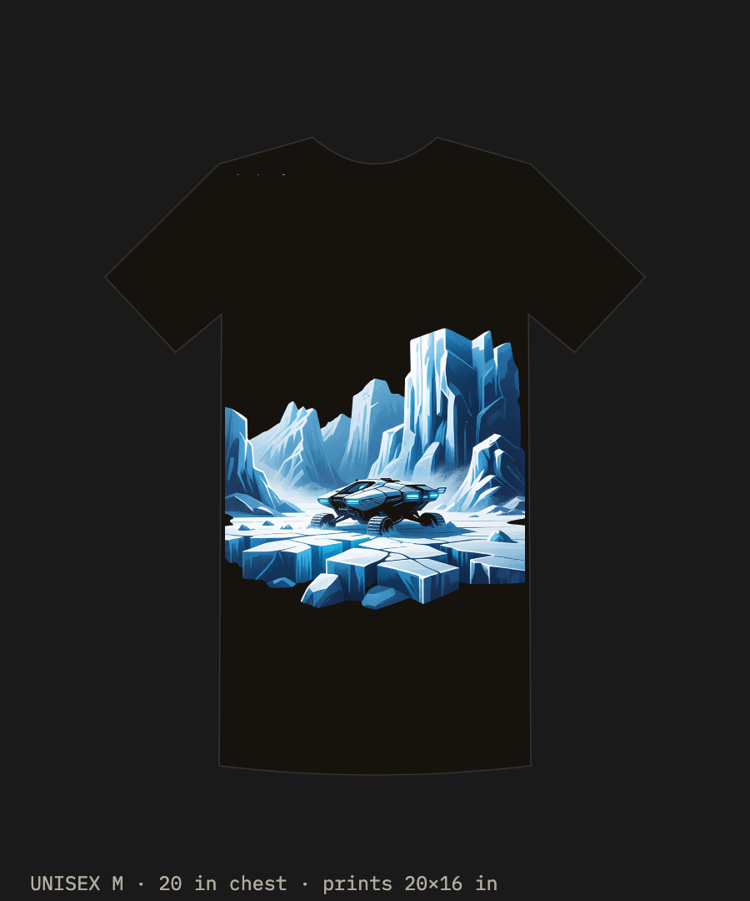

# Icescape ice rover



An AI image generator drew a low wedge on broken ice and it was approved as a shirt graphic. This project reads that drawing as a machine: a four-wheel-drive, four-wheel-steer rover for Antarctic sea ice and sastrugi, and for icy ground offworld (a lunar cold trap, the Martian polar cap).

The on-body photo (`images/reference-on-body.png`) is a different drawing of the same idea, a closed shell in charcoal. The model follows the flat layout: four open wheels, a wedge, a glazed canopy, a light bar on the nose, and a small mast at the tail.

The CAD is in STEVE, revision 5: [Icescape ice rover](https://stevecad.studio/?document=f8cc6c6d-7e09-4967-b523-ca7eb8466de5).

## Reading the image

| In the layout | Read as | In the model |
|---|---|---|
| Low wedge | Hull, belly 280 mm above the ice | Aluminium shell, 560 mm wide, about 12 mm in profile and 8 mm on the sides |
| Four large open wheels | Ø680 mm, foam-filled for Antarctica | Dish rim and a tyre annulus. The offworld metal wheel is in the source (`mission = 1`) and was not generated |
| Glazed canopy | Instrument window | Polycarbonate pane. The internal height is the bay, and there is no seat |
| Cyan strip on the nose | Light bar | Aluminium bar, 2 mm off the windshield slope |
| Small tab at the tail | Antenna mast | Stainless tube |
| Hardware in the wheel wells | A steer actuator and a drive actuator at each corner | Eight linked joint shells, pedestal off |

The nose skid is the Antarctic ground-penetrating-radar cover. The same bay is a spectrometer envelope in the offworld reading. Neither instrument has a performance number here. The rear deck is a solar cover for Antarctica and a radiator face offworld. Offworld power is a battery pack for a trip out from a depot.

## What it reuses

Each corner carries two of the robits joint actuators.

- The linked part is the bare shell, [Joint actuator (press3)](https://stevecad.studio/?document=bc629926-9ece-4fbd-be5a-2ed0af340ca2), revision 2, with `pedestal=0`, diameter 120 mm, length 110 mm. Eight of them.
- The 5:1 stage inside that shell, and the torque, are the [unknown-machine actuator](../unknown-machine/) (STEVE document `02e31a10-ac9e-489a-8c91-1a4ce6a43b71`): sun 18, planet 27, ring 72, module 1.
- The drive adds a second 5:1 in the hub. That stage is an envelope. The gears are not cut.
- Overall ratio 25:1. Each stage is taken at 0.90, so 0.81 overall. That efficiency is an assumption, not a measurement.

The motor is the Kollmorgen **KBM-17H01-C00**. The shop tools use the B winding, which has about twice the back-EMF. On a 48 V pack the B winding crawls. `requirements/motor.toml` at 900 rpm and 48 V:

```
PASS   KBM-17H01-C00
FAIL   KBM-17H01-A00     bus_vdc_needed 113.7 (needs <= 48)
FAIL   KBM-17H01-B00     bus_vdc_needed 60.3 (needs <= 48)
FAIL   ILM 85x13         cont_torque_nm 1.44; peak_torque_nm 4.66
FAIL   KBM-17H02-C00     stator_length_mm 86.8; bus_vdc_needed 62.8
```

Catalog values, page 20 of the KBM guide: continuous 2.07 N·m, peak 6.35 N·m, Kb 21.5 Vrms/krpm. The card is `parts/frameless-motors/kollmorgen-kbm-17h01-c.toml`.

## How it moves

Frame: X forward, Y to the left, Z up. Origin on the ice, midway between the axles. Wheel centres at (±640, ±590, 340) mm.

Each corner is a swing arm on the hull (revolute about X, ±6°), a steer actuator fixed to the arm, an upright on the kingpin (revolute about Z, ±22°), a drive actuator fixed to the upright, and a hub and wheel on the axle (revolute about Y). The right-hand corners are the left-hand part turned 180° about Z. The clevis is two ears with a gap; the pin is the joint.

Poses: `crab` at 20° on all four kingpins, `bump` at +6° on the left and −6° on the right, so all four wheels rise. The `traverse` animation is a 12 s loop. Fit check at rest, crab, and bump: clear, 300 pairs, 8 touching, no interferences. The eight touches line up with the four kingpin seats and the four hub seats.

| | |
|---|---|
| Envelope | 2300 × 1330 × 820 mm |
| Extent | x −1020..1280, y −665..665, z 0..820 mm |
| Mass, CAD | 241.872 kg. Centre of mass (34.0, 0, 426.9) mm |
| Hull | 148.3 kg |
| One wheel | 15.9 kg (aluminium dish, polycarbonate annulus) |
| Eight actuator shells | 19.7 kg |
| Cells, not in the CAD | 12.5 kg, about 2 kWh at 160 Wh/kg. The modelled pack is an empty aluminium case |

The tyre uses polycarbonate only as a density stand-in for a foam-filled tyre, the same stand-in as the band-saw tyres. STEVE draws that body green.

## Mobility

From `analysis/hand_calcs.py`, which prints:

```
operating mass 254.4 kg  (CAD 241.872 + cells 12.5)
ratio 25:1   efficiency 0.81   bus 48 V   Vrms 29.4

wheel torque   cont 41.9 N·m    peak 128.6 N·m
tractive force cont 493 N       peak 1513 N
as a fraction of weight   cont 0.20    peak 0.61
no-load speed  1.95 m/s     speed at continuous torque 1.31 m/s

grade, continuous torque, after rolling resistance:
  hard ice       Crr 0.02   grade 10.1°  (18%)
  packed snow    Crr 0.10   grade 5.6°  (10%)
  soft snow      Crr 0.20   grade -0.1°  (-0%)

steer torque at the kingpin   cont 9.3 N·m   peak 28.6 N·m
scrub 150 mm    load per wheel 624 N
highest friction it can steer against   cont 0.10   peak 0.31

packed-snow cruise 1.31 m/s   electrical 515 W   2 kWh lasts 3.9 h (18 km)
```

The 48 V speed is an estimate. Sine PWM is taken as 0.612 of the bus in line-line RMS, and the torque-speed line is drawn from peak torque, treated as stall, to that no-load speed. It is not a drive datasheet number.

Steering is the same actuator, direct on the kingpin, with no extra sector. Continuous steer holds on ice. Peak covers packed snow while the wheel is rolling. Stationary steer on rock, around μ 0.6, is past this actuator. A 2:1 sector would be the next change. It is not in the model.

On soft snow the continuous force is about equal to the rolling resistance, so it holds level and does not climb. Peak still moves it.

Open water is outside this design. The skid clearance is 272 mm and the rover has no flotation.

Belly clearance over a sine ridge, both axles on the surface, suspension locked:

```
flat ground 272 mm
wavelength 2 m  amplitude 100 mm   gap 124 mm
wavelength 2 m  amplitude 200 mm   gap -13 mm  STRIKE
wavelength 4 m  amplitude 200 mm   gap 208 mm
wavelength 4 m  amplitude 400 mm   gap 164 mm
```

A 2 m ridge of 200 mm strikes the skid. The ±6° of swing, about 40 mm at the wheel, is not in that check. [analysis/belly-gap.mp4](analysis/belly-gap.mp4) is the same geometry as particles in Gravity: the rover stays centred, the ridge scrolls, and `observe()` reports the gap. It is a kinematic picture, not a dynamics solve.

## Files

```
images/            the shirt layout, and the on-body photo
source/            STEVE design. main.py places the corners, joints, poses, animation, fit check
requirements/      motor.toml, checked with tools/partsel
analysis/          hand_calcs.py, gravity/belly_gap.js, belly-gap.mp4
exports/step/      icescape.step, plus one STEP per component and the linked actuator
exports/stl/       one mesh per body, named instance-body.stl, with manifest.json
```

Rebuild by opening the STEVE document, or by loading `source/` as a design. `params.py` holds the stance, the actuator size, and `mission`.

## Caveats

This is a speculative concept model. It is not engineered, tested, or certified for any load or use, and it carries no warranty. See the [repo license](../LICENSE).

The hull is a 12 mm aluminium shell, 148 kg, because that is the shape that was built. A 3 mm skin on a frame would be a different mass. The hub gears are an envelope. The linked shells do not contain the KBM motor or the 5:1 gears; those live in the unknown-machine actuator. Mission 1, the metal wheel, was not generated. The cells are a mass in the hand calculation, not a solid in the CAD.
