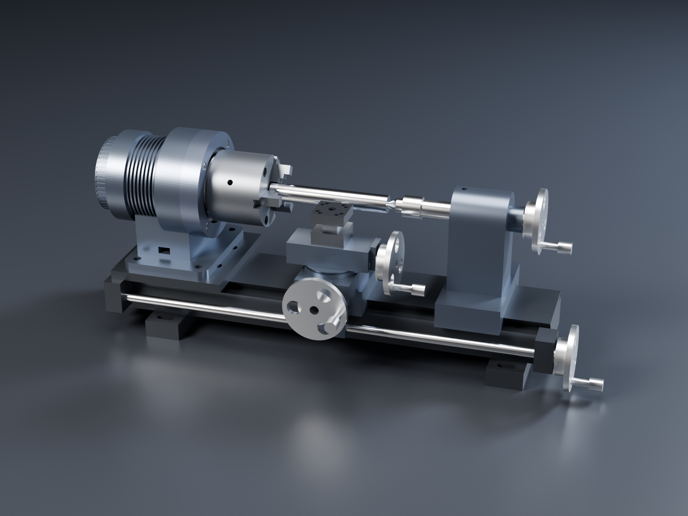
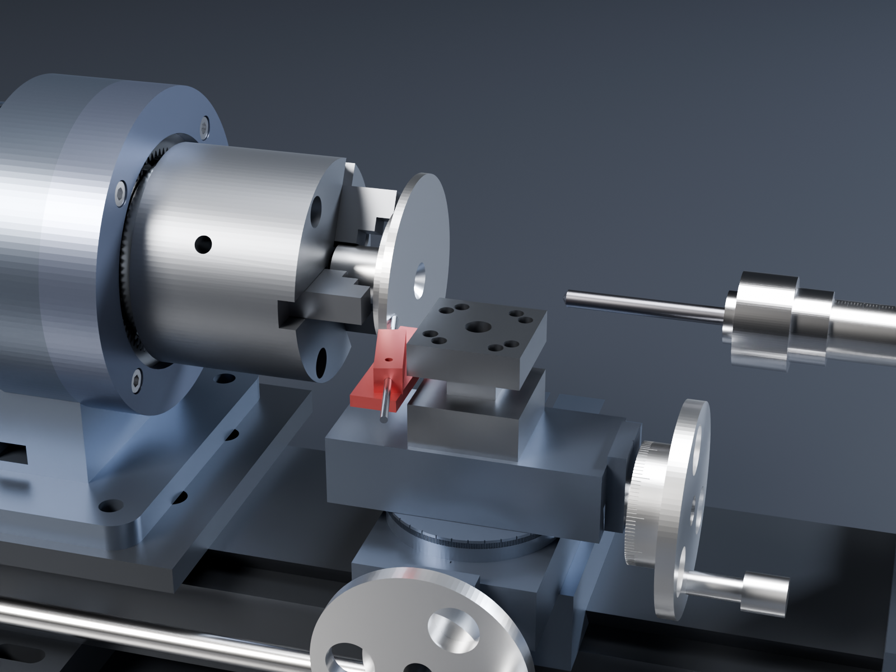

# Lathe kit: a manual mini lathe built on the unknown-machine actuator

The [unknown-machine joint actuator](../unknown-machine/) is a good small-lathe headstock as it is: a
crossed-roller output bearing and a 5:1 planetary give low speed and high torque, which is what HSS tooling on
steel wants. This kit adds everything else for a classic hand-operated hobby lathe, with no CNC and no electronic
leadscrew: handwheels, graduated dials, a degree scale on the compound and an engraved tailstock quill.

STEVE design: [Manual mini lathe (unknown-machine accessory catalogue)](https://stevecad.studio/?document=98a99a95-122c-4111-938b-02c01a86c017),
revision 3. It links the actuator (revision 36) and the chuck backplate, and passes its fit check (300 part
pairs). The CadQuery source is in [`source/`](source/).

## Main numbers

| | |
|---|---|
| Centre height / swing over the bed | 98 mm / 196 mm |
| Between the chuck jaws and the live centre | up to about 200 mm (tailstock and quill back) |
| Spindle | 0–1060 rpm; 18 N·m for short cuts, 10 N·m all day (motor's continuous rating, base bolted to metal) |
| Spindle bore | 8 mm through the actuator, 16 mm through the chuck and backplate |
| Carriage travel | about 105 mm on the leadscrew (more by sliding the tailstock away) |
| Cross-slide / top slide travel | 40 mm / ±20 mm; the compound swivels ±60° |
| Tailstock quill | 30 mm travel, MT1 taper, engraved 0–35 mm |
| Every dial | 100 lines on a 2 mm-pitch screw = **0.02 mm per line** (0.04 mm on diameter for the cross-slide) |
| Bed | 500 × 100 × 45, 6061 with a 55° dovetail, brass gibs |

## Why the gearbox, not a bigger motor

Cutting steel with HSS wants a slow spindle and plenty of torque, and the 5:1 planetary gives exactly that. Below
are the surface speeds for HSS, turned into rpm and capped at the actuator's 1060 rpm:

| Material (HSS tool) | Surface speed | Ø10 | Ø20 | Ø40 | Ø60 |
|---|---|---|---|---|---|
| Mild steel | about 28 m/min | 890 rpm | 450 | 220 | 150 |
| Free-cutting brass | about 50 m/min | 1060 | 800 | 400 | 265 |
| 6061 aluminium | about 75 m/min | 1060 | 1060 | 600 | 400 |

Cutting loads on a Ø40 mild-steel part (specific cutting force about 2000 N/mm²):

| Cut | Depth × feed | Cutting force | Spindle torque | Power at 28 m/min |
|---|---|---|---|---|
| Finish | 0.25 × 0.05 mm | 25 N | 0.5 N·m | 12 W |
| Medium | 0.5 × 0.1 mm | 100 N | 2 N·m | 47 W |
| Rough | 1.0 × 0.15 mm | 300 N | 6 N·m | 140 W |

Even the roughing cut uses a third of the short-term torque, and it sits within the 10 N·m continuous rating. A
direct-drive spindle would need a motor about five times bigger for the same torque at 220 rpm. The limit on
this lathe is rigidity, not power, the same as on any small lathe: take light cuts on steel.

## The catalogue

Made parts (all in the STEVE design, one file each in `source/components/`):

| Part | Material | Notes |
|---|---|---|
| Chuck backplate | AISI 303 | Pilots on the Ø20 output hub; 6 × M4 × 12 into the output disk; Ø55 spigot for the chuck. Separate STEVE part ([link](https://stevecad.studio/?document=b55f2ff3-a103-4a53-9ea2-28fac9591a3e)); 9.4 MPa at 18 N·m + 300 N cutting force 60 mm out |
| Headstock plate | 6061, black anodised | The pedestal's 4 × M8 on top, 4 × M6 into the bed |
| Bed | 6061, hard anodised | 55° male dovetail; hard-anodise the ways or fit steel strips for wear |
| Bed feet (2) | 6061 | Slotted for bench bolts |
| Carriage | 6061 | Rides the bed on a brass gib (3 × M4 adjusters, M5 lock); cross-slide dovetail on top; leadscrew nut in the apron |
| Carriage gib | Brass (C36000) | |
| Cross-slide | 6061 | Tr10 × 2 screw in a slot in the carriage dovetail; zero mark for the compound scale |
| Compound swivel base | 6061 | Engraved ±60°, 1° lines, long every 10° |
| Top slide | 6061 | Carries the tool post |
| 4-way tool post | 34CrNiMo6 QT (or 4140) | Four pockets for 8 mm HSS on a 1 mm shim, so the edge sits on centre; 2 × M6 clamps per side |
| Tailstock | 6061 | Ø20 quill bore on centre, quill lock, M8 base lock, quill-screw bearing |
| Quill | Steel (C60) | MT1 nose, engraved 0–35 mm |
| Leadscrew brackets (2) | 6061 | Bronze bushes; zero line for the carriage dial |
| Handwheels (4, identical) | 6061 hub and dial, satin | 100-line dial, Ø70 wheel, crank |

Bought parts:

| Part | Spec | Notes |
|---|---|---|
| 3-jaw chuck | 80 mm, front mount (DIN 6350 style): Ø55 recess, 3 × M6 on PCD 66 | e.g. [Bison 3274-80](https://store.bison-chuck.com/uk/en/3-jaw-self-cent-scroll-chuck-3274-80.html), [Soba via Chronos](https://www.chronos.ltd.uk/product/new-80mm-front-mount-3-jaw-chuck); check the recess and bolt circle before machining the backplate |
| Live centre | MT1, 60° | |
| Feed screws and nuts | Tr10 × 2 rolled screw, bronze nuts (4 sets) | Leadscrew about 505 mm long; three short ones |
| Tool bits | HSS 8 × 8 | Ground to suit; 1 mm shims |
| Screws | 6 × ISO 4762 M4 × 12 (backplate), M6 / M8 for the plates and feet, M4 gib screws | A2-70 or 8.8 |

### Accessories (STEVE branch `accessories`)

| Accessory | What it is | Notes |
|---|---|---|
| Tungsten grinding hub | Steel arbor with a Ø20 shank in the 3-jaw chuck, Ø75 plated-diamond disc on its flange (countersunk M6, flush) | Ø75 keeps the disc clear of the top slide. About 4 m/s at 1060 rpm: slower than a dedicated grinder (about 13 m/s), fine for diamond on tungsten |
| Tungsten holder | 8 × 8 shank for the tool post's +Y pocket, L-plate round the post, bored block at 15° to the disc face | Grinds a 30° point with the marks lengthwise. Bore a sliding fit for 2.4 mm, with sleeves for 1.6 / 3.2. Turn the tungsten by hand, feed 0.02 mm a line on the carriage dial, sweep with the cross-slide. Make a 22.5° version (`half_angle`) for 45° points |
| ER16 collet chuck, MT1 (bought) | Goes in the tailstock quill in place of the live centre; ER16 collets hold 1–10 mm | Drill to depth with the quill scale and dial |

Grinding dust is hard on the bed's ways and slides: cover them with a cloth or a magnetic sheet while you grind,
and use lanthanated or ceriated tungsten (thoriated dust is radioactive). The branch's `sharpen` animation shows the
cycle: back the tip off, feed it onto the disc, sweep it across, back off. Its fit check passes (351 pairs).

Every dial has its zero line engraved on the part next to it: the right-hand leadscrew bracket, the cross-slide
bracket, the top-slide bracket and the tailstock end cap. The compound scale reads against a mark on the
cross-slide.

## Moving it in STEVE

Every slide is a joint coupled to its handwheel at 2 mm per turn: `carriage_feed`, `cross_feed`, `compound_feed`
and `quill_feed`. `compound_angle` swivels the compound. The `turning_pass` animation feeds the tool in, traverses
40 mm toward the chuck, backs out and returns.

## Not done yet

- No stress study of the bed or slides yet; the bed's stiffness under cutting load is the next one to run.
- No threading: a manual lathe would need change gears to the leadscrew, and the spindle has no gear output.
  The actuator's encoder could drive an electronic leadscrew later, but that is outside "manual only".
- The chuck and live centre are envelopes at catalogue size, not the makers' models.
- The STEVE design still holds two unused files, `shapes.py` and `params.py`, from before they were renamed to
  `lathe_shapes.py` and `lathe_params.py`. The rename works around a STEVE bug: a linked design picks up the
  parent design's modules when their names match (filed with the render bug report).
- Further accessories for the catalogue:
  - a milling attachment: a column on the bed in place of the headstock plate, the actuator moved onto a vertical
    slide with a dial, and the work in a small vise on the cross-slide (X, Y and Z from the carriage, cross-slide
    and column)
  - a disc sander: a Ø200 disc on the chuck backplate with a table on the cross-slide; about 11 m/s, half a normal
    sander's speed
  - a 4-jaw independent chuck, a faceplate, a fixed steady and a parting tool holder
  - a bench grinder: a poor fit for this gearbox. 1060 rpm is too slow for vitrified wheels (8 m/s on Ø150
    against 25-35 m/s), so it wants a direct-drive version of the motor or CBN wheels
