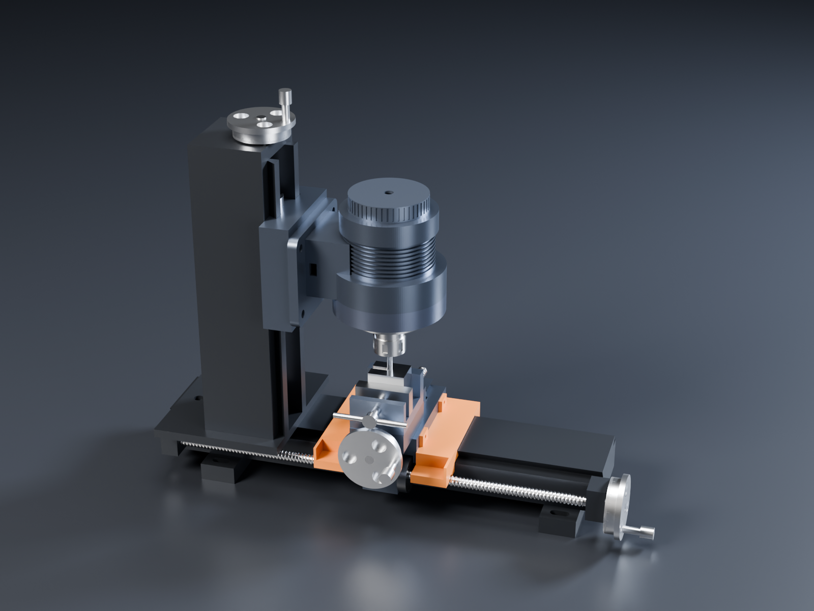

# Lathe kit: a manual mini lathe built on the unknown-machine actuator

The [unknown-machine joint actuator](../unknown-machine/) is a good small-lathe headstock as it is: a
crossed-roller output bearing and a 5:1 planetary give low speed and high torque, which is what HSS tooling on
steel wants. This kit adds everything else for a classic hand-operated hobby lathe, with no CNC and no electronic
leadscrew: handwheels, graduated dials, a degree scale on the compound and an engraved tailstock quill. The carriage
and cross-slide run on ball screws, and printed covers keep the chips and grit off the ways.

The shop around it, each on its own STEVE design:

- **[Milling attachment](#milling-attachment-steve-branch-milling)**: the same actuator moved onto a column on the bed
  (branch `milling` of the lathe design).
- **[Bench grinder](bench-grinder/)**: a separate machine on a pedestal stand, with the same KBM motor in direct
  drive (no gearbox).
- **[Disc sander](disc-sander/)**: a separate machine on a bench stand, with a second complete actuator.
- **[Cold saw](cold-saw/)**: a metal-cutting chop saw on a stand. An actuator drives a 20:1 worm gearbox to turn a
  Ø250 HSS blade at 0–53 rpm, with about 150 N·m at the blade.
- **[Vertical band saw](band-saw/)**: a separate machine on a stand. An actuator drives the lower wheel through a 5:1
  timing belt, giving a blade speed of 0–166 m/min set on the drive, with a tilting table.

STEVE design: [Manual mini lathe (unknown-machine accessory catalogue)](https://stevecad.studio/?document=98a99a95-122c-4111-938b-02c01a86c017),
revision 13. It links the actuator (revision 36) and the chuck backplate, and passes its fit check (435 part
pairs). The CadQuery source is in [`source/`](source/); the branches' `main.py` files are in
[`source/branches/`](source/branches/) (every other file is shared with main).

## Main numbers

| | |
|---|---|
| Centre height / swing over the bed | 98 mm / 196 mm |
| Between the chuck jaws and the live centre | up to about 200 mm (tailstock and quill back) |
| Spindle | 0–1060 rpm; 18 N·m for short cuts, 10 N·m all day (motor's continuous rating, base bolted to metal) |
| Spindle bore | 8 mm through the actuator, 16 mm through the chuck and backplate |
| Carriage travel | about 105 mm on the leadscrew (more by sliding the tailstock away); 4 mm per turn |
| Cross-slide / top slide travel | 40 mm / ±20 mm; the compound swivels ±60° |
| Tailstock quill | 30 mm travel, MT1 taper, engraved 0–35 mm |
| Every dial | **0.02 mm per line** (0.04 mm on diameter for the cross-slide): 200 lines on the 4 mm-lead ball screws (carriage, cross-slide), 100 lines on the 2 mm-pitch Tr10 screws (compound, quill) |
| Feed screws | SFU1204 ball screws (Ø12, 4 mm lead) on the carriage and cross-slide; Tr10 × 2 on the compound and the tailstock quill |
| Bed | 500 × 100 × 45, 6061 with a 55° dovetail, brass gibs |

## Why the gearbox, not a bigger motor

Cutting steel with HSS wants a slow spindle and plenty of torque, and the 5:1 planetary gives exactly that. Below
are the surface speeds for HSS, turned into rpm and capped at the actuator's 1060 rpm:

| Material (HSS tool) | Surface speed | Ø10 | Ø20 | Ø40 | Ø60 |
|---|---|---|---|---|---|
| Mild steel | about 28 m/min | 890 rpm | 450 | 220 | 150 |
| Free-cutting brass | about 50 m/min | 1060 | 800 | 400 | 265 |
| 6061 aluminium | about 75 m/min | 1060 | 1060 | 600 | 400 |

Cutting loads on a Ø40 mild-steel part (specific cutting force about 2000 N/mm²):

| Cut | Depth × feed | Cutting force | Spindle torque | Power at 28 m/min |
|---|---|---|---|---|
| Finish | 0.25 × 0.05 mm | 25 N | 0.5 N·m | 12 W |
| Medium | 0.5 × 0.1 mm | 100 N | 2 N·m | 47 W |
| Rough | 1.0 × 0.15 mm | 300 N | 6 N·m | 140 W |

Even the roughing cut uses a third of the short-term torque, and it sits within the 10 N·m continuous rating. A
direct-drive spindle would need a motor about five times bigger for the same torque at 220 rpm. The limit on
this lathe is rigidity, not power, the same as on any small lathe: take light cuts on steel.

## Ball screws, and where they stay as Tr screws

Yes, the slides want ball screws, and the carriage and cross-slide now have them: SFU1204 rolled ball screws,
Ø12 with a 4 mm lead, in flanged ball nuts. The milling column's Z axis uses the same screw. They turn with almost
no friction, wear far less than a plain nut, and with a preloaded nut (oversize balls, or a DFU double nut) the dial
has no backlash to take up. With 200 lines on a Ø60 dial, one line is still 0.02 mm.

| Slide | Screw | Nut | Why |
|---|---|---|---|
| Carriage (leadscrew) | SFU1204, grooved 460 mm, Ø10 journals | Flanged, in a housing under the carriage's front edge, flange flat toward the bed | Long traverse at 4 mm a turn, and the most used dial |
| Cross-slide | SFU1204, 180 mm, moves with the slide | Flanged, in a block on the carriage behind the slide; the screw tail shows behind the carriage as the slide comes forward | Facing and sizing to the dial |
| Mill Z | SFU1204, 280 mm, vertical in the column | Flanged, on top of the slide's nut block | Fine down-feed |
| Compound | Tr10 × 2 (unchanged) | Bronze | Set once for a taper and left; a Tr screw holds its place without a lock |
| Tailstock quill | Tr10 × 2 (unchanged) | Bronze | Drilling thrust would push a ball screw back |

The catch with ball screws on a hand machine is that they **back-drive**: the cut can push the slide and spin the
wheel. Three things deal with it:

- **Drag plugs.** Each screw bracket has a spring-loaded brass drag plug on the journal, so the wheel stays where you
  leave it.
- **Locks.** There is a carriage lock (M5 onto the ways) and a Z-slide lock lever. Lock whatever slide isn't
  feeding.
- **The mill head's weight.** The head is about 60 N on the Z screw, only 0.04 N·m at the wheel, so the drag plug
  holds it.

Each screw's end load goes into two AXK1024 needle thrust washers either side of its bracket.

In the model the ball groove is drawn as a ring every 4 mm rather than as a helix. STEVE's kernel returns no solid
when a helical sweep is cut into the shaft. The rings look the same at this scale, and the screw's size, lead and
travel are exact.

## Way covers (3D printed)

Two printed covers, in orange PETG or ASA, screw to the ends of the carriage with 2 × M4 × 10 each. They ride with
the carriage, so they are always over the stretch of ways where the chips and grinding grit land:

- **Section.** A roof 2.4 mm over the dovetail, side skirts, and a shelf over the leadscrew.
- **End wall.** It clears the bed by 1 mm. Stick a felt wiper strip inside it.
- **Size and printing.** Each cover is about 40 × 150 × 40 mm. Print it standing on its carriage end: the tabs and
  wall edges sit flat on the plate, and the end wall's only bridges are the 1–20 mm gaps around the bed profile, so
  it needs no supports. About an hour each.
- **Wear part.** When one is worn or chewed, print another and swap it in two minutes. The STLs are in
  [`exports/`](exports/) (`way_cover_left.stl`, `way_cover_right.stl`, in mm, in their place on the lathe).
- **Length.** They are 40 mm long so the left one still clears the headstock plate at the carriage's left-hand stop.
  The right one meets the tailstock 40 mm earlier than the bare carriage would, so slide the tailstock back for
  long traverses.

## The catalogue

Made parts (all in the STEVE design, one file each in `source/components/`):

| Part | Material | Notes |
|---|---|---|
| Chuck backplate | AISI 303 | Pilots on the Ø20 output hub; 6 × M4 × 12 into the output disk; Ø55 spigot for the chuck. Separate STEVE part ([link](https://stevecad.studio/?document=b55f2ff3-a103-4a53-9ea2-28fac9591a3e)); 9.4 MPa at 18 N·m + 300 N cutting force 60 mm out |
| Headstock plate | 6061, black anodised | The pedestal's 4 × M8 on top, 4 × M6 into the bed |
| Bed | 6061, hard anodised | 55° male dovetail; hard-anodise the ways or fit steel strips for wear |
| Bed feet (2) | 6061 | Slotted for bench bolts |
| Carriage | 6061 | Rides the bed on a brass gib (3 × M4 adjusters, M5 lock); cross-slide dovetail on top; leadscrew nut in the apron |
| Carriage gib | Brass (C36000) | |
| Cross-slide | 6061 | Tr10 × 2 screw in a slot in the carriage dovetail; zero mark for the compound scale |
| Compound swivel base | 6061 | Engraved ±60°, 1° lines, long every 10° |
| Top slide | 6061 | Carries the tool post |
| 4-way tool post | 34CrNiMo6 QT (or 4140) | Four pockets for 8 mm HSS on a 1 mm shim, so the edge sits on centre; 2 × M6 clamps per side |
| Tailstock | 6061 | Ø20 quill bore on centre, quill lock, M8 base lock, quill-screw bearing |
| Quill | Steel (C60) | MT1 nose, engraved 0–35 mm |
| Leadscrew brackets (2) | 6061 | Bronze bushes; zero line for the carriage dial |
| Handwheels (4, identical) | 6061 hub and dial, satin | 100-line dial, Ø70 wheel, crank |

Bought parts:

| Part | Spec | Notes |
|---|---|---|
| 3-jaw chuck | 80 mm, front mount (DIN 6350 style): Ø55 recess, 3 × M6 on PCD 66 | e.g. [Bison 3274-80](https://store.bison-chuck.com/uk/en/3-jaw-self-cent-scroll-chuck-3274-80.html), [Soba via Chronos](https://www.chronos.ltd.uk/product/new-80mm-front-mount-3-jaw-chuck); check the recess and bolt circle before machining the backplate |
| Live centre | MT1, 60° | |
| Ball screws | SFU1204 rolled, C7: leadscrew 505 mm overall (grooved 460, Ø10 journals both ends), cross screw 207 mm (grooved 180, Ø10 journal at the front) | Order with the ends machined (BK10-style Ø10 journals) |
| Ball nuts | 2 × SFU1204 flanged (Ø24 body, Ø40 flange with a flat, 4 × Ø4.5 on PCD 32), preloaded | Preload (or DFU double nuts) for no backlash |
| Thrust washers | AXK1024 + 2 × AS1024, two sets per ball screw | Either side of the handwheel bracket |
| Tr screws and nuts | Tr10 × 2 rolled screw, bronze nut (2 sets: compound, quill) | Short |
| Way covers | 2 printed, PETG or ASA, 4 perimeters | Plus felt strip 3 mm for the wipers |
| Tool bits | HSS 8 × 8 | Ground to suit; 1 mm shims |
| Screws | 6 × ISO 4762 M4 × 12 (backplate), M6 / M8 for the plates and feet, M4 gib screws | A2-70 or 8.8 |

### Accessories (STEVE branch `accessories`)

| Accessory | What it is | Notes |
|---|---|---|
| Tungsten grinding hub | Steel arbor with a Ø20 shank in the 3-jaw chuck, Ø75 plated-diamond disc on its flange (countersunk M6, flush) | Ø75 keeps the disc clear of the top slide. About 4 m/s at 1060 rpm: slower than a dedicated grinder (about 13 m/s), fine for diamond on tungsten |
| Tungsten holder | 8 × 8 shank for the tool post's +Y pocket, L-plate round the post, bored block at 15° to the disc face | Grinds a 30° point with the marks lengthwise. Bore a sliding fit for 2.4 mm, with sleeves for 1.6 / 3.2. Turn the tungsten by hand, feed 0.02 mm a line on the carriage dial, sweep with the cross-slide. Make a 22.5° version (`half_angle`) for 45° points |
| ER16 collet chuck, MT1 (bought) | Goes in the tailstock quill in place of the live centre; ER16 collets hold 1–10 mm | Drill to depth with the quill scale and dial |

Grinding dust is hard on the ways and the ball screws. The printed way covers take most of it; also lay a cloth over
the cross-slide while you grind, and use lanthanated or ceriated tungsten (thoriated dust is radioactive). The
branch's `sharpen` animation shows the cycle: back the tip off, feed it onto the disc, sweep it across, back off.
Its fit check passes (496 pairs).

For general grinding, use the separate [bench grinder](bench-grinder/), which runs at the right surface speed for
vitrified wheels. The lathe hub is for tungsten only.

## Milling attachment (STEVE branch `milling`)

No separate T-slot table: the lathe's own slides become the mill's X and Y, and the motor moves. The conversion
takes about 15 minutes:

1. Take the chuck, backplate and compound off, and slide the tailstock off the end.
2. Undo the actuator's 4 × M8 from the headstock plate, and the plate's 4 × M6 from the bed.
3. Bolt the milling column to the bed with the same 4 × M6 in the same holes.
4. Bolt the actuator's pedestal to the front of the Z slide with the same 4 × M8. The actuator now hangs with its
   spindle pointing down.
5. Put the ER20 adapter on the output disk with the backplate's 6 × M4 × 12.
6. Put the vise on the cross-slide, on the compound's M8 pivot stud. It swivels, so square it with the zero mark.

| | |
|---|---|
| X / Y / Z travel | about 90 mm (carriage) / 40 mm (cross-slide) / 120 mm (column slide) |
| Dials | 0.02 mm a line on all three (SFU1204 ball screws, 200-line dials) |
| Spindle | ER20 collets (1–13 mm), 0–1060 rpm, 18 N·m short-term and 10 N·m all day |
| Column | 6061, 80 × 90 × 318, 55° dovetail with a brass gib and lock lever; lightening pockets in the back |
| Vise | 60 mm jaws, opens to 45 |
| Spindle to column dovetail face | 110 mm |

The column, Z slide and ER20 adapter are made parts (6061 for the column and slide, 303 for the adapter). The
ball screw and nut are the same SFU1204 as on the lathe. Its fit check passes (378 pairs). The `slotting` animation
feeds a 6 mm slot 20 mm along X, lifts the cutter, returns, and goes back down.

The speeds are a steel-and-brass mill's. A Ø6 cutter at 1060 rpm is 20 m/min, right for HSS in mild steel but
slow for aluminium. In aluminium, use Ø12–16 cutters (40–53 m/min) or a fly cutter. The gearbox's torque is what
lets a hobby mill take a real cut: 10 N·m at the spindle is about 3 kN of cutting force on a Ø6 cutter, far more
than this column's stiffness will take.

Every dial has its zero line engraved on the part next to it: the right-hand leadscrew bracket, the cross-slide
bracket, the top-slide bracket and the tailstock end cap. The compound scale reads against a mark on the
cross-slide.

## Moving it in STEVE

Every slide is a joint coupled to its handwheel: `carriage_feed` and `cross_feed` at 4 mm per turn (ball screws),
`compound_feed` and `quill_feed` at 2 mm per turn (Tr10), and in the milling branch `z_feed` at 4 mm per turn.
`compound_angle` swivels the compound. The `turning_pass` animation feeds the tool in, traverses 40 mm toward the
chuck, backs out and returns.

## Not done yet

- No stress study of the bed or slides yet; the bed's stiffness under cutting load is the next one to run, and
  the milling column's (a 120 mm overhang) with it.
- The drag plugs, thrust washers, lock levers and gibs on the column are described but not modelled.
- No threading: a manual lathe would need change gears to the leadscrew, and the spindle has no gear output.
  The actuator's encoder could drive an electronic leadscrew later, but that is outside "manual only".
- The chuck and live centre are envelopes at catalogue size, not the makers' models.
- The STEVE design still holds two unused files, `shapes.py` and `params.py`, from before they were renamed to
  `lathe_shapes.py` and `lathe_params.py`. The rename works around a STEVE bug: a linked design picks up the
  parent design's modules when their names match (filed with the render bug report).
- Further accessories for the catalogue: a 4-jaw independent chuck, a faceplate, a fixed steady and a parting
  tool holder.
