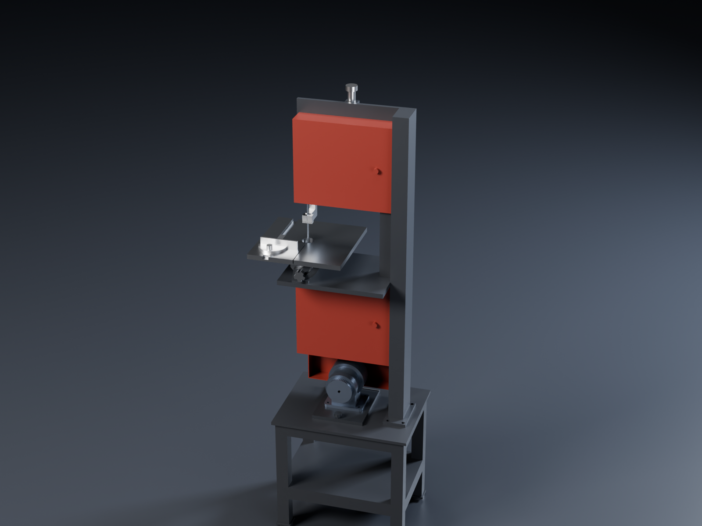
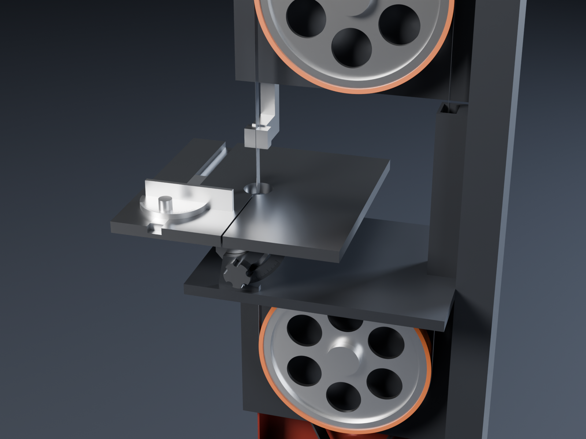

# Vertical band saw: a second actuator and a 5:1 belt, on a stand

This is a separate machine, a small vertical metal-cutting band saw. It is driven by a complete
[unknown-machine actuator](../../unknown-machine/) (revision 36: KBM-17H01 motor, 5:1 planetary and pedestal,
unchanged) through a second 5:1 stage: an HTD 8M timing belt to the lower wheel. Like the rest of the shop it has
hand controls and engraved scales:
- a tilt scale on the table trunnion, read by a pointer on the lock knob
- a mm scale on the upper guide post
- a blade-tension scale beside the tension slider

There are no step pulleys or gearbox, because the drive sets the blade speed.

STEVE design: [Vertical band saw (unknown-machine actuator, 5:1 belt) on stand](https://stevecad.studio/?document=dfd1e326-6afe-4a48-8424-5f3ef7a349e1),
revision 3. It links the actuator (revision 36) and passes its fit check: 153 instance pairs at rest, with the
table at 45° and with the guide at full height. The CadQuery source is in [`source/`](source/).

## Main numbers

| | |
|---|---|
| Wheels | 2 × Ø250 over urethane tyres, 6061 centres, on 6204-2RS bearings |
| Blade | 1829 mm (72 in) bi-metal M42, 6–13 mm wide × 0.65 |
| Blade speed | **0–166 m/min**, set on the drive (wheel 0–212 rpm); the full continuous torque up to 154 m/min |
| Torque at the lower wheel | 50 N·m continuous (3.11 A), 90 N·m short-term (5.9 A drive limit) |
| Blade pull | 400 N continuous, 715 N short-term |
| Power at 40 m/min (mild steel) | 270 W continuous, 480 W short-term; about 1 kW continuous at 150 m/min (aluminium) |
| Throat (blade to column) | 280 mm |
| Under the guide | 0–100 mm (engraved on the guide post) |
| Table | 300 × 300, tilts 0–45° (left side down) on trunnions; 3/4 in miter slot and a ±60° miter gauge |
| Table height | 1000 mm |
| Footprint | stand 450 × 340; overall height about 1500 mm to the tension knob |

## Speeds and torque against a ½ hp metal band saw

Blade speed is the wheel's rpm times the blade's pitch circumference round the wheel (π × 250.65 mm = 0.787 m):

| Material (bi-metal blade) | Blade speed | Wheel | Actuator output |
|---|---|---|---|
| Stainless, tool steel | 15–20 m/min | 19–25 rpm | 95–127 rpm |
| Mild steel | 35–40 m/min | 44–51 rpm | 222–254 rpm |
| Brass, bronze | 60–90 m/min | 76–114 rpm | 381–571 rpm |
| Aluminium, plastics | 120–150 m/min | 152–190 rpm | 762–952 rpm |

| | This saw | Typical ½ hp 4 × 6 metal band saw |
|---|---|---|
| Speeds | 0–166 m/min, any speed | 3 steps, about 24 / 37 / 61 m/min (80 / 120 / 200 ft/min) |
| Motor | 1 kW-class servo, 5:1 planetary, 5:1 belt | 373 W induction, belt and worm or pulleys |
| Pull on the blade at 40 m/min | 400 N continuous, 715 N short-term | about 400–500 N (300 W or so delivered) |
| At slow speed (stainless) | full torque at any speed | the low step only |

At mild-steel speed it has about the pull of a ½ hp saw, with more in reserve. The real gain is that every
material gets its own blade speed, including the slow speeds stainless needs and the fast ones aluminium needs.
The actuator runs at 95–950 rpm here, inside its flat-torque range (to 981 rpm on the continuous current; see the
[motor curves](../../unknown-machine/analysis/)), and the motor's continuous rating depends on current, not speed.
Set the drive's current limit to suit the blade: a 6 mm blade needs much less than 400 N.

## Belt and blade calculations

**Belt.**
- **The proposed belt was too small.** A 15 mm HTD 5M belt on a 16T pulley would carry 10.3 N·m / 12.7 mm =
  810 N of tooth load continuously, several times its rating at this speed.
- **What's used instead:** HTD 8M, 30 mm wide, 20T / 100T. The pitch diameters are 50.93 / 254.65 mm, so the
  ratio is 5.00.
- **Tooth load:** 10.3 N·m / 25.5 mm = 405 N continuous and 720 N short-term. That is well inside an 8M 30 mm
  belt's rating at 100–1000 rpm, but check the belt maker's table.
- **Pulley size.** Gates suggests 22 grooves minimum for 8M HTD. A 22T / 110T pair (the same 5:1) on a
  1120-8M-30 belt would run at about 273 mm centres. Its Ø280 pulley needs the guard and the motor plate moved
  down by about 35 mm.
- **Belt length** for the 1000-8M-30 belt (125 teeth):
  L = 2C + π(D + d)/2 + (D − d)²/4C → 1000 = 2C + 480.0 + 10 376 / C → **C = 238.2 mm**
- **Tension.** The actuator's motor plate is hinged at the back with a jack screw at the front. Lowering the front
  shortens the centre distance; raising it tensions the belt. It's an old-school motor platform, and the pedestal
  stays bolted as it is.

**Blade.**
- 1829 mm (72 in) is a stock length.
- L = 2C + π × D_pitch, with D_pitch = 250 + 0.65 → **C = (1829 − 787.4) / 2 = 520.8 mm** between the wheel
  centres, at nominal tension. The model uses 520.9.
- The tension slot gives the idler wheel ±20 mm of travel, so the frame takes blades from about 1790 to 1870 mm.
- The blade tension scale beside the slot has four lines: slack (blade change), 6 mm, 10 mm and 13 mm blades.

## Parts

Made parts (one file each in `source/components/`):

| Part | Material | Notes |
|---|---|---|
| C-frame | S235 steel, welded and machined (a cast-iron casting in production) | Column on the right; upper and lower wheel plates behind the wheels; bearing boss for the drive shaft; tension slot; shelf for the trunnions and lower guide; return-run channel; guide-post bushing with lock knob; tension-screw bracket; 4 × M10 into the stand |
| Band wheels (2) | 6061 | Rim, web with six windows, hub; Ø20 shafts. The lower one's shaft carries the 100T pulley |
| Tension slider | Steel | Idler wheel's bearings; M10 tension screw, spring stack and knob; tracking screw at the back |
| Upper guide | Ground steel post 20 × 20, bronze side blocks | Head straddles the blade (blocks 0.1 mm off, thrust face 0.5 mm behind); mm scale on the post |
| Lower guide | Steel, bronze blocks | Fixed under the table, 42 mm down, so the table tilts over it |
| Table | Cast iron (steel in the model) | Ø40 throat for a phenolic insert, blade-change slot to the front, miter slot; cheeks with M8 lock studs |
| Trunnions (2) | 6061, black | Sector plates about the tilt axis with arc slots; 0–45° scale on the front one |
| Miter gauge | 6061 head, steel bar | ±60° protractor and fence |
| Drive pulley hub | AISI 303 | The chuck backplate's pattern: Ø20 pilot, 6 × M4 × 12 into the output disk |
| Driven pulley | 6061 | HTD 8M 100T, 30 mm (or buy one) |
| Motor plate | 12 mm steel | Hinged at the back, jack screw at the front; pedestal 4 × M8 tapped |
| Wheel covers, belt guard | 2 mm / 1.5 mm steel, powder coated | Hinged doors with knobs; chip brush inside the lower cover |
| Stand | S235, 40 × 40 × 3 box section | 10 mm top plate, shelf, M12 levelling feet |

Bought parts:

| Part | Spec | Notes |
|---|---|---|
| Actuator | unknown-machine, complete, with its pedestal and 240 Vac drive | The same unit as the lathe headstock and the disc sander |
| Blades | 1829 × 13 × 0.65 bi-metal M42: 10/14 TPI general, 14/18 thin wall, 6 mm for curves | |
| Timing belt | HTD 1000-8M-30 (125 T) | |
| Drive pulley | HTD 8M 20T × 30 (taper-lock), on the 303 hub | Or 22T with a 110T driven pulley |
| Tyres | Urethane, for 10 in wheels (Ø250 × 20) | Stretch on; crown slightly |
| Bearings | 4 × 6204-2RS | Two in the lower boss, two in the tension slider |
| Guide blocks | Bronze or phenolic (or swap in ball-bearing guides) | |
| Tension spring | Die spring, Ø24 OD, about 35 mm | |
| Screws | M10 (frame), M8 (pedestal, trunnions, table studs), M6 / M5 (covers, guard) | 8.8 |
| Levelling feet | M12, Ø50 pads (4) | |

## Moving it in STEVE

- `blade_drive` turns the drive pulley five turns for each turn of the wheels (`pulley_spin`, `lower_spin` and
  `upper_spin` coupled). The blade and belt are drawn static.
- `guide_height` raises the upper guide 0–95 mm from where it is modelled (40 mm above the table).
- `table_tilt` tilts the table from 0 to −45° (left side down).
- `miter_slide` moves the gauge along its slot.
- The `cut` animation runs the wheels and pushes the miter gauge through the blade.
- The poses `bevel_45` and `full_height` are in the fit check.

## Not done yet

- No stress or vibration study yet. The places to check are:
  - the C-frame's stiffness under blade tension (about 1–1.5 kN on a 13 mm bi-metal blade)
  - the column's deflection
  - the lower wheel's shaft overhang to the pulley
- The blade's teeth and the belt's teeth aren't drawn. The tyres use a plastic stand-in material, and the table is
  steel in the model (cast iron specified).
- The guide blocks are drawn as plain blocks, and the tracking mechanism only as its knob. There's no sliding blade
  guard between the upper guide and the upper cover yet.
- Screws aren't declared with `design.fasten`, so the build doesn't run a thread-engagement check on them.
- The drive, the stop switch and the wiring aren't modelled.
- Each component is a single body (a compound where it has several pieces). STEVE's mesh export (`bodies_mesh`)
  merges a component's bodies into one STL, so a part that needs its own colour in the renders has to be its own
  component. That's why the tyres are separate components.
- STEVE can't export animation video through its API. Export `cut` from the Motion tab.
