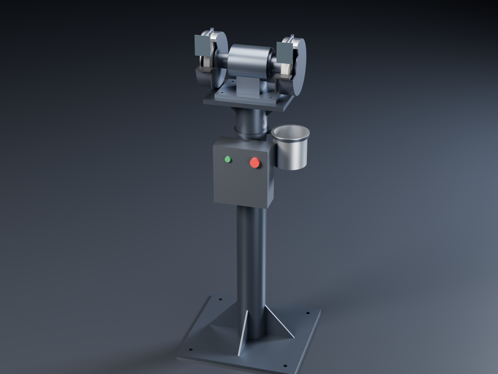
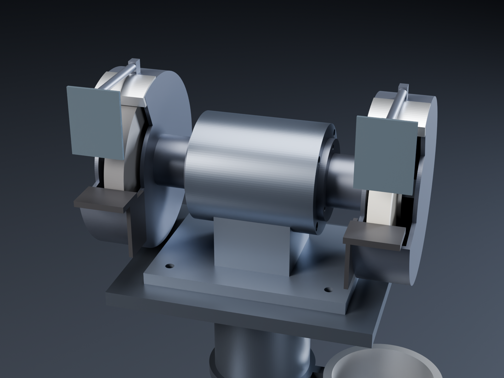

# Bench grinder: the unknown-machine motor, direct drive, on a pedestal stand

This is a separate machine from the lathe. It uses the same Kollmorgen KBM-17H01-B00 frameless motor and the same
240 Vac servo drive as the [joint actuator](../../unknown-machine/), but it has **no gearbox**. The actuator's 5:1
planetary tops out at 1060 rpm, which gives 8 m/s on a Ø150 wheel; vitrified wheels want 25 to 35 m/s. Here the
rotor sits directly on the wheel spindle, and the drive's speed limit is set to 3450 rpm, the speed of an ordinary
two-pole bench grinder.

STEVE design: [Bench grinder (unknown-machine motor, direct drive) on pedestal stand](https://stevecad.studio/?document=35f9f6f7-d5ef-419a-8bb5-8a860884225a),
revision 3. Its fit check passes (300 part pairs, no clashes). The CadQuery source is in [`source/`](source/).
The `spin_up` animation runs the spindle up to speed.

## Main numbers

| | |
|---|---|
| Wheels | 2 × Ø150 × 20: A36 (coarse, left) and WA80 (white, right), rated 4140 rpm / 35 m/s or more |
| Spindle speed | 3450 rpm (the drive's speed limit; the motor runs to 5300 rpm unloaded on the 325 V bus, so the limit is the drive setting, not the motor) |
| Surface speed | 27 m/s on a new Ø150 wheel; 22 m/s at Ø120 |
| Torque at 3450 rpm | 2.1 N·m continuous (3.11 A), 3.8 N·m short-term at the drive's 5.9 A limit |
| Power at 3450 rpm | 0.77 kW continuous (about 1 hp), 1.36 kW short-term |
| Wheel centre height | 1020 mm from the floor |
| Tool rests | 2 mm from the wheel, at the wheel centre height |
| Guard opening | 10° below to 65° above the horizontal (the ANSI B7.1 / EN 12413 limit for bench grinders) |
| Spindle | 42CrMo4, Ø20 at the bearings and wheels, Ø30 rotor seat; M20 × 1.5 nuts, left-hand thread on the left |
| Bearings | 2 × 6204-2RS (rated far above 3450 rpm) |
| Stand footprint | 420 × 420 base plate, 4 × Ø14 holes for floor anchors |

### Against a normal bench grinder

A ½ hp grinder (373 W) makes about 1.0 N·m at 3450 rpm, and a ⅓ hp one about 0.7 N·m. This head gives 2.1 N·m
all day, so it will not stall under a heavy push. Real grinding takes 200 to 400 W. At 300 W the motor draws about
1.2 A and its copper loss is about 13 W, so it runs cool. (At the full continuous rating the copper loss is
87 W; the KBM's continuous rating assumes the stator can shed that heat, and here it can only go through the
aluminium barrel into the air.)

The servo drive also does things an induction grinder can't:

- **Soft start.** The rotor, shaft and two wheels add up to about 3.8 × 10⁻³ kg·m², so the drive could reach
  speed in 0.4 s. Set a 2 s ramp instead, to go easy on the wheels.
- **Braked stop.** The drive can stop the wheels in a few seconds instead of letting them coast for a minute. Keep
  the deceleration ramp at 3 s or more, because a hard stop works against the wheel nuts. It also needs the
  drive's brake resistor.
- **The same surface speed as the wheel wears.** At Ø120 the wheel can run at up to 4140 rpm (26 m/s), but only
  when that is within the speed marked on the wheel. **Never set the drive above the wheel's marked rpm.**

## Why direct drive and not the actuator

| | Actuator (5:1) | Direct drive |
|---|---|---|
| Top speed | 1060 rpm | 3450 rpm (set), 5300 rpm possible |
| Ø150 wheel | 8 m/s: too slow for vitrified wheels, which glaze and wear unevenly | 27 m/s |
| Torque | 18 N·m: far more than grinding needs | 2.1 N·m continuous, 2 × a ½ hp grinder |
| Parts | Gearbox, crossed-roller bearing, carrier | One shaft and two 6204 bearings |

The lathe needs the gearbox, because it turns steel slowly and with high torque. A grinder needs surface speed.
With the same motor and drive in both machines, they share spares and setup.

## Parts

Made parts (one file each in `source/components/`):

| Part | Material | Notes |
|---|---|---|
| Spindle shaft | 42CrMo4 QT, ground | Ø30 rotor seat, Ø24 bearing shoulders, Ø20 journals and wheel seats; M20 × 1.5 ends, LH thread on the left |
| Barrel | 6061, black anodised | Stator bonded into a Ø85 bore; 4 × M5 tapped each end; 2 × M6 underneath into the foot; Ø14 cable port underneath |
| End bells (2) | 6061, black anodised | Ø47 pocket for a 6204 against an outer shoulder; 4 × M5 through into the barrel; 3 × M5 tapped for the guard; room for a 20 × 30 lip seal on the spacer |
| Spacer tubes (2) | Steel, ground | Bearing inner race to inner flange; the shaft nut clamps the whole stack against the shaft shoulder |
| Wheel flanges (4) | Steel | Ø60, relieved in the middle so they clamp on the rim. Use the wheel's blotters |
| Wheel guards (2) | Cast aluminium (or welded 3 mm steel) | Neck on the end bell (3 × M5); closed shroud 10 mm round the new wheel; arm and clamp for the eye shield |
| Spark deflectors (2) | Zinc-plated steel | 3 mm off the wheel; slotted so they can follow the wheel down as it wears |
| Tool rests (2) | Steel | 33 × 50 table at the wheel centre; the arm bolts through a slot to the guard wall. Keep the rest within 3 mm of the wheel |
| Eye shields (2) | Polycarbonate 3 mm | 50 × 65. Wear safety glasses as well |
| Head foot | Cast iron, or a 6061 weldment | Saddle for the barrel, 200 × 150 flange; 4 × M8 to the stand, Ø16 cable hole |
| Pedestal stand | S235 weldment, powder coated | 420 × 420 × 12 base, Ø101.6 × 3.6 column, 260 × 200 × 15 top plate, six gussets. The motor cable runs down inside the column |
| Quench pot (optional) | Steel | Ø110 cup on a ring bracket round the column. For HSS; never quench carbide |

Bought parts:

| Part | Spec | Notes |
|---|---|---|
| Frameless motor | Kollmorgen KBM-17H01-B00 (stator and rotor) | Same as the actuator. The 52 mm stator bore and 50 mm rotor OD are estimates until the Kollmorgen 3D model is in |
| Servo drive | Same 240 Vac drive as the actuator, with a brake resistor | Speed limit 3450 rpm, 2 s acceleration ramp, 3 s deceleration ramp. It needs rotor feedback: a Hall or encoder kit on the free shaft end, or the actuator's read head arrangement (not modelled) |
| Grinding wheels | 150 × 20 × 20 bore (or 32 bore with bushes), vitrified, rated at least 4140 rpm | A36 for roughing, WA60–80 for HSS tool bits. Ring-test every wheel before you fit it |
| Diamond wheel (option) | Ø150 plated diamond or CBN, 20 bore | Swap it for the white wheel to grind carbide and tungsten electrodes. A dedicated electrode holder on the tool rest would go with it (the lathe's [tungsten holder](../README.md) does the same job on the lathe) |
| Bearings | 2 × 6204-2RS | |
| Lip seals | 2 × 20 × 30 × 5 | On the spacers, in the end bells |
| Drive box | Steel enclosure about 180 × 80 × 200 with a mains switch, a green start and a red mushroom e-stop | Strapped to the front of the column. The model is a plain envelope |
| Screws | 8 × M5 (end bells), 6 × M5 (guards), 2 × M6 (barrel), 4 × M8 with nuts (foot), 4 × M12 floor anchors | |

## Not done yet

- No stress or modal study. The spindle's first bending mode, with a wheel overhung 125 mm from each bearing, is
  the one to check against 3450 rpm (57.5 Hz).
- No rotor feedback is modelled. The drive needs an encoder or Hall sensors, and a cover on the free shaft end
  would hold them.
- Wheel masses in the STEVE model use steel as a stand-in material. Real vitrified wheels are about 0.6 kg each,
  not 2.7 kg.
- The drive box is an envelope, not a real enclosure, and the stator and rotor carry the same estimated sizes as
  the actuator.
- The wheel guards don't yet have the adjustable slots for the rests and deflectors: those are holes to add
  once the parts are drawn for making.
