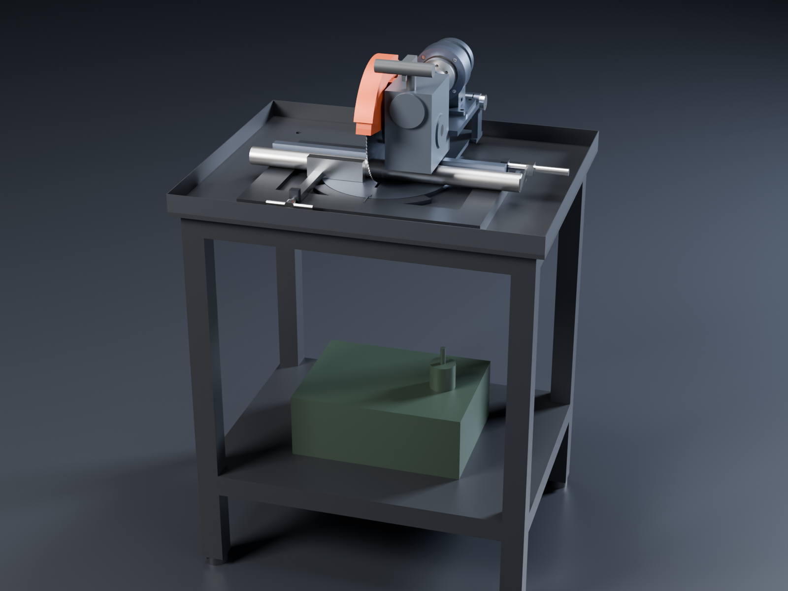
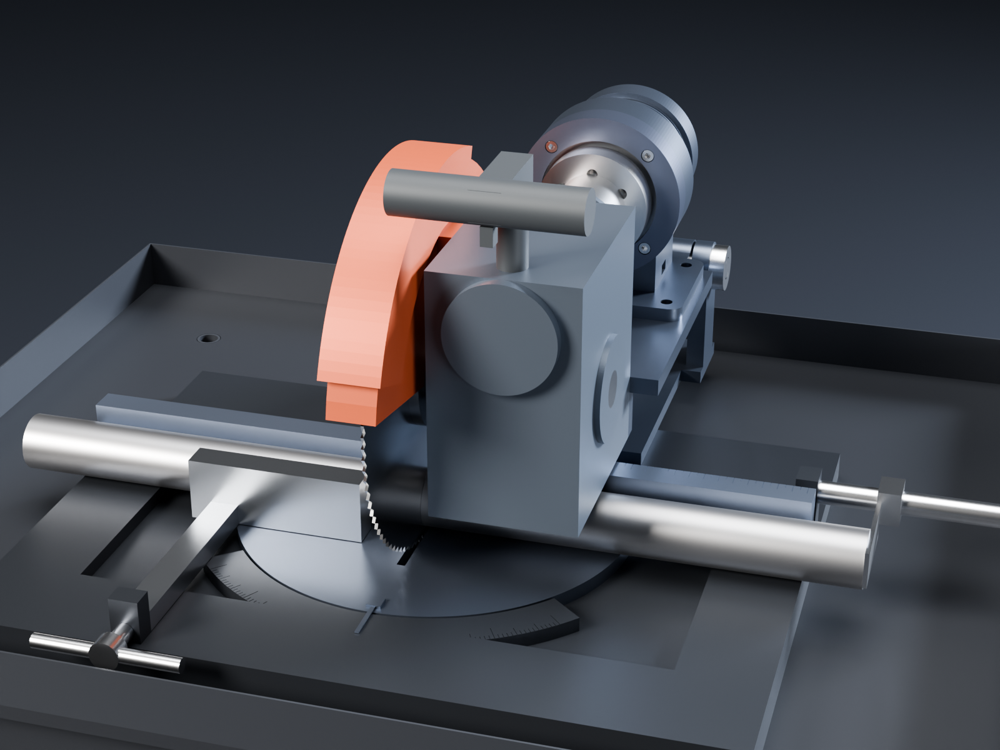

# Cold saw: an unknown-machine actuator and a 20:1 worm gearbox on a stand

This is a separate machine, not a lathe attachment. It is a metal-cutting cold saw (a chop saw with a slow HSS
blade, not an abrasive wheel). A complete [unknown-machine actuator](../../unknown-machine/) sits on its bolted
pedestal on the saw's head plate and drives a Ø250 HSS blade through a bought 20:1 worm gearbox, the same kind of
reduction a commercial cold saw uses.

How it works:

- **Cutting.** The head pivots down to cut on a pin at the back, and springs lift it back up.
- **Mitres.** The head swings 45° either way on a turntable, read on an engraved degree scale.
- **Holding the work.** A quick-action vise, a fence with an engraved mm rule, and a length stop.
- **Coolant and chips.** A tray round the stand top drains to a coolant tank and pump on the shelf.

Like the lathe, it has hand controls and index marks only.

STEVE design: [Cold saw (unknown-machine actuator, worm reduction) on stand](https://stevecad.studio/?document=62815535-5ad6-4164-9277-ff55f4b11b44),
revision 2. It links the actuator (revision 36) and passes its fit check: 231 instance pairs, checked with the head
down at the end of a cut, with the head raised, and raised at 45° mitre both ways. The CadQuery source is in
[`source/`](source/).

## Main numbers

| | |
|---|---|
| Blade | Ø250 × 2.0 HSS cold-saw blade, Ø32 bore, 2 pin holes on PCD 54, 100 teeth (200 for thin-wall tube) |
| Blade speed | 0–53 rpm, set on the drive; **45 rpm (35 m/min) for mild steel** at 900 rpm on the actuator |
| Torque at the blade | about 150 N·m continuous (10.3 N·m × 20 × 0.75 worm efficiency); keep it under the gearbox's 194 N·m maximum by setting the drive's current limit to about 3.9 A for short-term use |
| Force at the teeth | about 1.2 kN continuous |
| Power | about 0.94 kW into the gearbox, about 0.73 kW at the blade |
| Capacity | about Ø45 round or 45 square (Ø40 bar shown). The limit is the worm gearbox's case, 48 mm above the table on the right of the blade, not the blade (Ø250 could take about 70) |
| Mitre | ±45° on the turntable, engraved scale with a line every degree (long every 5°, longer every 15°) |
| Heights | stand top 900 mm, work table 930 mm |
| Footprint | stand 800 × 640 |

## Speed and torque against a commercial cold saw

| | This saw | Typical 250 mm cold saw |
|---|---|---|
| Motor | 1 kW-class servo (KBM-17 on the actuator's 5:1 planetary) | 1.1 kW induction |
| Reduction after the motor | 20:1 worm (NMRV063) | worm gearbox, about 30:1 to 60:1 from 1400 rpm |
| Blade speed | 0–53 rpm, any speed | usually 2 speeds, such as 45 and 90 rpm |
| Torque at the blade | about 150 N·m continuous | about 150–200 N·m |

The torque matches a commercial saw. What this saw lacks is the high speed (about 90 rpm) a two-speed saw uses
for aluminium and brass: here the top speed is 53 rpm (42 m/min), which cuts aluminium cleanly, only more slowly.
For a mostly-aluminium saw, fit the same gearbox with i = 10 instead. That gives 0–106 rpm and about 77 N·m,
still plenty for aluminium.

## Why the extra reduction

A cold saw cuts at 30–40 m/min with HSS on mild steel. On a Ø250 blade that is about 45 rpm. Straight off the
actuator, 45 rpm with 10 N·m is about 47 W, so it would stall in the first cut. The worm gearbox lets the actuator
run at about 900 rpm, near the top of its torque curve where it makes about 0.94 kW, and turns that into about
20 times the torque at the blade. A second planetary stage would keep more of the torque (about 95 % efficiency
against 75 %). The worm makes the drive a compact right angle and, at this ratio, doesn't back-drive much, which is
why cold saws use one.

## Parts

Made parts (one file each in `source/components/`):

| Part | Material | Notes |
|---|---|---|
| Base | 6061, black | Plate with raised pads in front and at the sides; mitre scale ring engraved −45 to +45°; vise screw block and length-stop bracket |
| Turntable | 6061 | Ø280, blade slot, pointer for the scale, arm out to the pivot cheeks |
| Head plate | 6061 | Takes the actuator's pedestal (its 4 × M8), the gearbox bracket at the front, and the pivot knuckle at the back |
| Drive hub | AISI 303 | The disc sander's hub pattern on the output disk (6 × M4 × 12, Ø20 pilot) with a Ø19 stub for the coupling |
| Blade arbor | 42CrMo4 (34CrNiMo6 in the model) | Ø25 keyed through the gearbox's hollow output, collar, inner flange, Ø32 blade seat with two drive pins, M24 left-hand nose |
| Outer flange and nut | C45 | Left-hand thread, so it tightens as the blade cuts |
| Upper guard | 2 mm steel, red | Fixed, bolted to the gearbox's side face; the coolant line clips to its front |
| Lower guard | 2 mm steel, red | Swings about the blade axis; hangs over the teeth with the head up, rides up over the work |
| Handle | Steel | Bolted to the gearbox's top face, with a trigger (dead-man) switch for the drive |
| Fence | 6061 with hardened steel faces | The vise's fixed jaw, two halves either side of the blade, mm rule on top |
| Vise jaw | C45 | On a slide beam from the screw block |
| Length stop | Steel | Ø16 rod and sliding stop finger |
| Pivot pin | Ground steel, Ø16 | With a torsion return spring outside each cheek |
| Stand | S235, welded | 50 × 50 × 3 box section, 10 mm top, 6 mm shelf |
| Chip and coolant tray | 1.5 mm steel | Rim round the stand top, drain to the tank |

Bought parts:

| Part | Spec | Notes |
|---|---|---|
| Actuator | unknown-machine, complete, with its pedestal and 240 Vac drive | The same unit as the lathe headstock and the disc sander |
| Worm gearbox | NMRV063 i = 20 with a solid input shaft (Motovario NMRV-P063 or equal) | Ø25 hollow output, 63 mm centre distance, about 194 N·m maximum output torque at 20:1 ([RS listing](https://twcn.rs-online.com/web/p/gearboxes/2166600)). The case in the model is an envelope at about catalogue size; check the real dimensions before machining the bracket and head plate |
| Jaw coupling | Ø50, Ø19 bores both ends, polyurethane spider | |
| Blade | Ø250 × 2.0 × 32 HSS-Co, 100 or 200 teeth | Resharpenable |
| Coolant pump | Small 230 V coolant pump, about 10 l/min | With a hose and a clip-on nozzle |
| Coolant tank | 20 l steel | Soluble oil, about 5 % |
| Screws and levelling feet | M8 for the pedestal, M6–M10 for the rest; M12 feet | A2-70 or 8.8 |

## Moving it in STEVE

- `mitre` swings the turntable and head ±45°.
- `chop` lowers the head from −35° (raised) to 0 (end of the cut).
- `lower_guard_swing` swings the lower guard down over the teeth (95°) or up out of the way (0°).
- `motor_spin` turns the drive hub and coupling. `drive` couples it to `blade_spin` at 20:1.
- `vise_travel` opens the vise. `stop_set` slides the length stop.
- The `chop` animation lowers the head through a cut with the guard riding up and the blade turning, then lifts
  it.
- The `raised`, `mitre_left` and `mitre_right` poses are in the fit check.

## Not done yet

- Capacity is only about 45 mm because the NMRV case hangs 72 mm below the blade axis, beside the blade and over
  the work. A narrower gear case near the blade, like a commercial saw's, or a longer arbor with a support bearing
  would open it up to about 70 mm.
- No stress or vibration study of the head plate, the pivot or the stand. Most of the cutting force goes through
  the pivot pin and cheeks, so those are the places to check.
- The gearbox is a catalogue-size envelope, not the maker's STEP. Its 194 N·m figure is from a distributor
  listing, so check the real rating in the maker's table for the service factor you want.
- The lower guard's pivot bearing, the turntable lock and the 0/45° detents, the springs' legs, the coolant hose
  and nozzle, and the wiring aren't modelled.
- The vise's quick-action half-nut is described, not modelled.
- The screws aren't declared with `design.fasten`.
- STEVE can't export animation video through its API. Export `chop` from the Motion tab.
