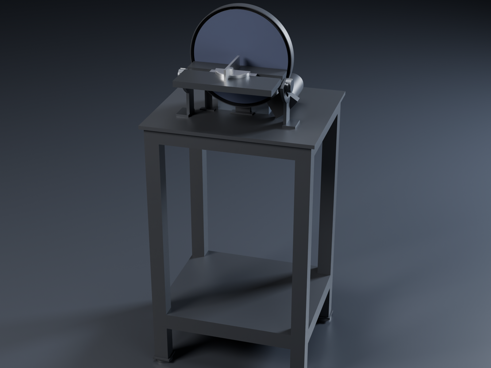
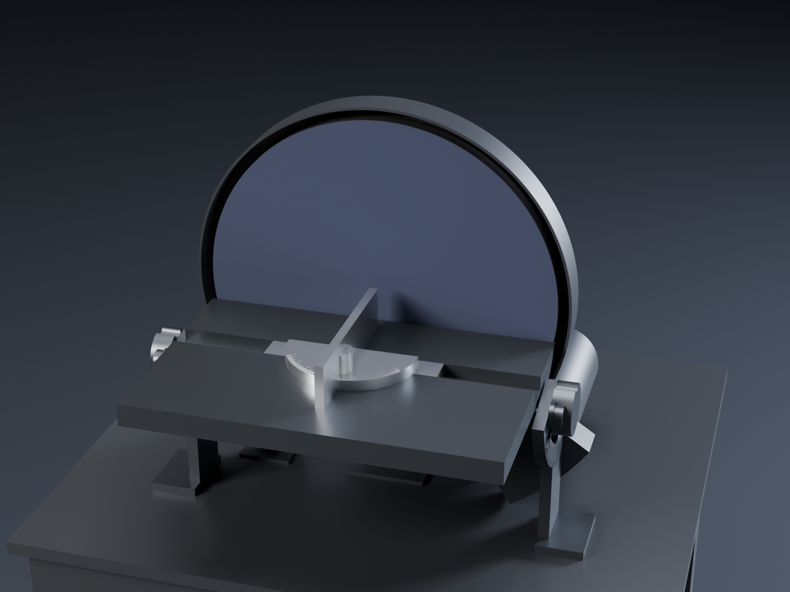

# Disc sander: a second actuator on a bench stand

This is a separate machine, not a lathe attachment. A second [unknown-machine actuator](../../unknown-machine/)
sits on its own bolted pedestal and turns a Ø250 (10 in) disc. The actuator is the complete unit at revision 36:
KBM-17H01 motor and 5:1 planetary, unchanged. A riser block lifts it on a welded bench stand. The machine has a
tilting table on trunnions with an engraved degree scale, a miter gauge, and a steel guard with a dust port. Like
the lathe, it has hand controls and index marks only.

STEVE design: [Disc sander (unknown-machine actuator) on bench stand](https://stevecad.studio/?document=67b4edd4-dfd3-45c1-9e4e-71beef642e43),
revision 1. It links the actuator (revision 36) and passes its fit check: 45 instance pairs, with the table both
flat and at 45°. The CadQuery source is in [`source/`](source/).

## Main numbers

| | |
|---|---|
| Disc | Ø250 (10 in) 6061 platen, 10 thick, PSA abrasive |
| Speed | 0–1060 rpm, set on the drive; **13.9 m/s at the rim** at full speed |
| Torque at the disc | 10.3 N·m continuous (the motor's 3.11 A rating), 18.3 N·m short-term on the 5.9 A drive |
| Force at the rim | about 82 N continuous, 146 N short-term |
| Power | about 1 kW continuous at 900–980 rpm (the actuator's curve: [motor curves](../../unknown-machine/analysis/)) |
| Table | 250 × 160, tilts 0–45° down; its near edge stays 3.5 mm from the abrasive at every angle (virtual pivot) |
| Miter slot / gauge | 3/4 × 3/8 in slot parallel to the disc; gauge protractor ±60°, 1° lines |
| Heights | table top 875 mm, disc centre 895 mm above the floor |
| Footprint | stand 460 × 400 (the table overhangs the front by 20) |
| Dust port | Ø63 (2.5 in) hose spigot at the back, from a hood low on the right |

## Speed and torque against a typical sander

| | This sander | Typical 1/2 hp 12 in disc sander |
|---|---|---|
| Speed | 1060 rpm, 13.9 m/s | 1725 rpm, about 27 m/s |
| Torque at the disc | 10.3 N·m continuous, 18.3 N·m short-term | about 2.1 N·m (373 W at 1725 rpm) |
| Force at the rim | 82 / 146 N | about 14 N |
| Power | about 1 kW continuous | 373 W |

The gearbox turns the motor's speed into torque. The disc runs at half the surface speed of a wood sander but
pushes five to ten times harder at the rim, so it doesn't slow down or stall when the work is pressed on.

- **Metal (good fit).** Deburring, squaring ends, breaking edges and shaping small parts all suit this speed.
  Slower abrasive cuts cooler, so thin edges and small parts are less likely to blue or burn. Use zirconia or
  ceramic discs in 60–120 grit.
- **Wood (it works, slowly).** It cuts more slowly than a wood sander, and the finish is a little coarser for the
  same grit. Go one grit finer than usual.
- **Reaching full speed.** The drive limits the actuator to its 1060 rpm no-load speed, so this is the ceiling.
  A faster disc needs the direct-drive motor arrangement used for the bench grinder (separate build).

With this much torque, a part that catches on the disc gets thrown, not stalled. Treat it like a bigger machine:
- Work only on the left half, which runs downward into the table.
- Hold small parts in a clamp or the miter gauge.
- Set the drive's current limit to what the job needs: 3.11 A gives the continuous rating, and lower is fine for
  light work.
- Wire a latching stop switch at the front of the stand (not modelled).

## Parts

Made parts (one file each in `source/components/`):

| Part | Material | Notes |
|---|---|---|
| Disc hub | AISI 303 | The chuck backplate's pattern, 20 thick: pilots on the Ø20 output hub, 6 × M4 × 12 into the output disk's load holes; 6 × M5 tapped on PCD 66 for the platen |
| Platen | 6061 | Ø250 × 10, 6 × M5 countersunk flush; face it true on its own hub after assembly |
| Riser block | 6061, anodised | 140 × 100 × 70; the pedestal's 4 × M8 go into it, 4 × M8 counterbored into the stand |
| Guard | 2 mm steel, welded, powder coated | Back wall between the platen and the actuator, rim band round the whole disc, dust hood and Ø63 port; two feet bolt to the stand top |
| Trunnions (2) | 6061, black | Sector plates on posts: two arc slots each about the table's near edge, engraved 0–45° scale (1° lines, long every 5°, longer every 15°) |
| Table | 6061, black, top faced | Miter slot; a cheek under each side carries two M8 studs through the trunnion slots, with a lock knob (pointer onto the scale) and a flanged nut |
| Miter gauge | 6061 head, steel bar | ±60° protractor and fence; modelled at 0° |
| Stand | S235 steel | 40 × 40 × 3 box section, welded; 10 mm top plate, 6 mm shelf |

Bought parts:

| Part | Spec | Notes |
|---|---|---|
| Actuator | unknown-machine, complete, with its pedestal and 240 Vac drive | The same unit as the lathe headstock |
| Abrasive discs | Ø250 (10 in) PSA, zirconia or ceramic, 60–120 grit | |
| Screws | 6 × ISO 4762 M4 × 12 (hub), 6 × ISO 10642 M5 × 12 (platen), M8 for the pedestal, riser, trunnions and guard | A2-70 or 8.8 |
| Levelling feet | M12, Ø50 pads (4) | |
| Lock knob | M8 five-lobe, Ø36 | |
| Dust hose | 2.5 in shop-vacuum hose | |

## Moving it in STEVE

- `disc_spin` turns the hub, platen and abrasive about the actuator's axis, anticlockwise seen from the front.
- `table_tilt` tilts the table on its trunnions from 0 to 45°.
- `miter_slide` moves the gauge ±50 mm along its slot.
- The `sanding` animation runs all three.
- The `bevel_45` pose is the table at 45°, and the fit check covers it.

## Not done yet

- No stress or vibration study. The places to check are the platen's flatness and run-out on the 303 hub, and the
  stiffness of the stand's top under the table.
- No airflow study of the dust hood. The port size is the usual 2.5 in shop-vacuum size.
- The miter gauge is fixed at 0° (there is no joint for its angle), and the trunnion's lock studs are drawn as
  plain studs.
- The screws aren't declared with `design.fasten`, so the build doesn't run a thread-engagement check on them.
- The drive, its enclosure, the stop switch and the wiring aren't modelled. On the lathe, the drive sits off the
  machine too.
- STEVE can't export animation video through its API (see the feature request filed for the actuator). Export
  `sanding` from the Motion tab.
