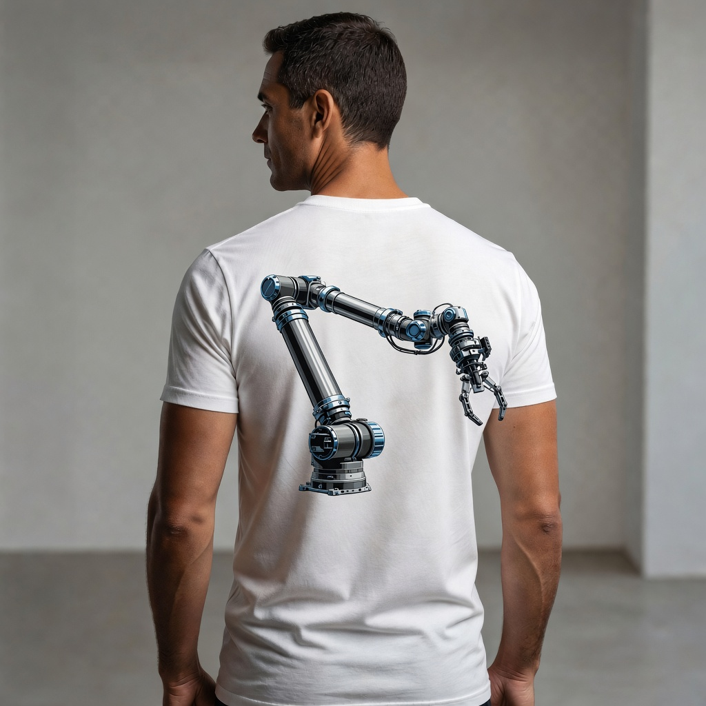
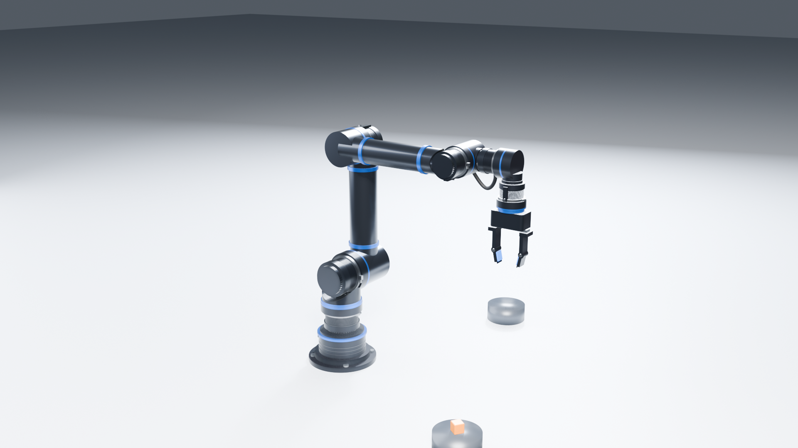
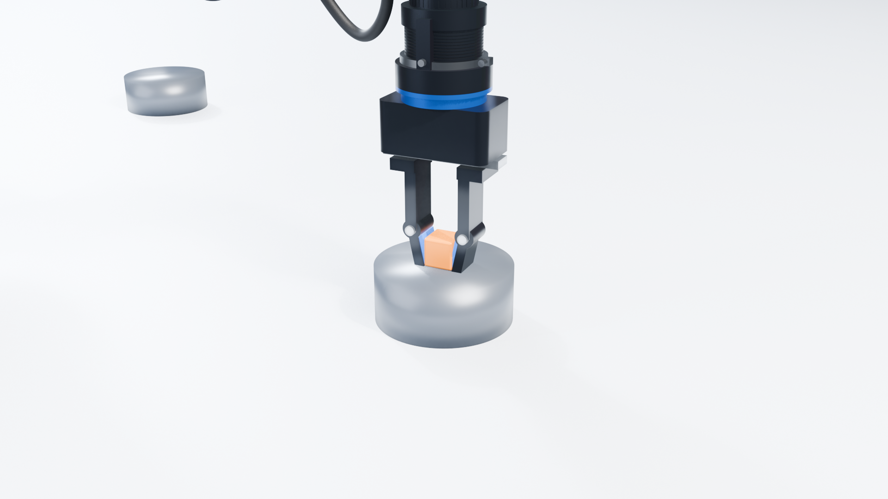
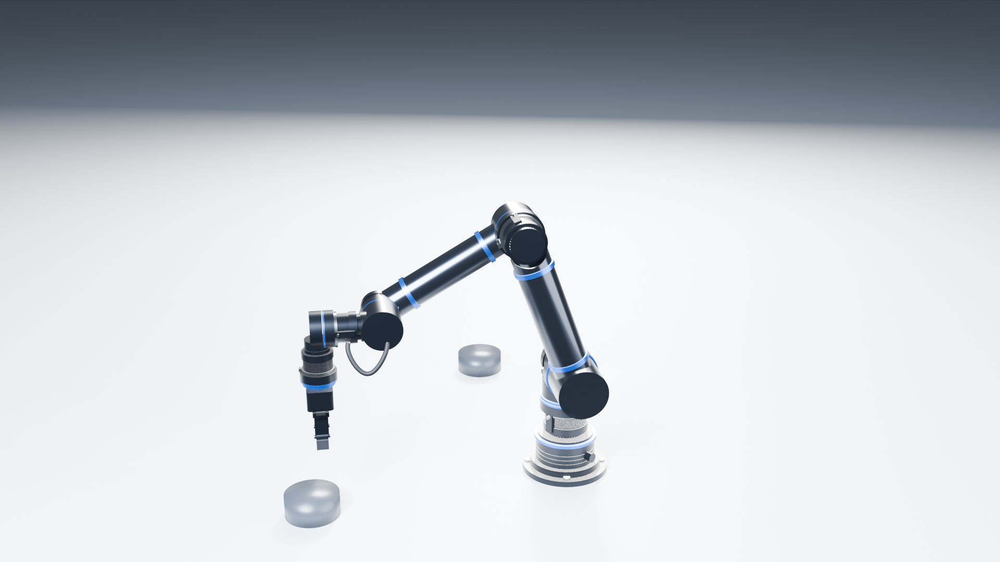
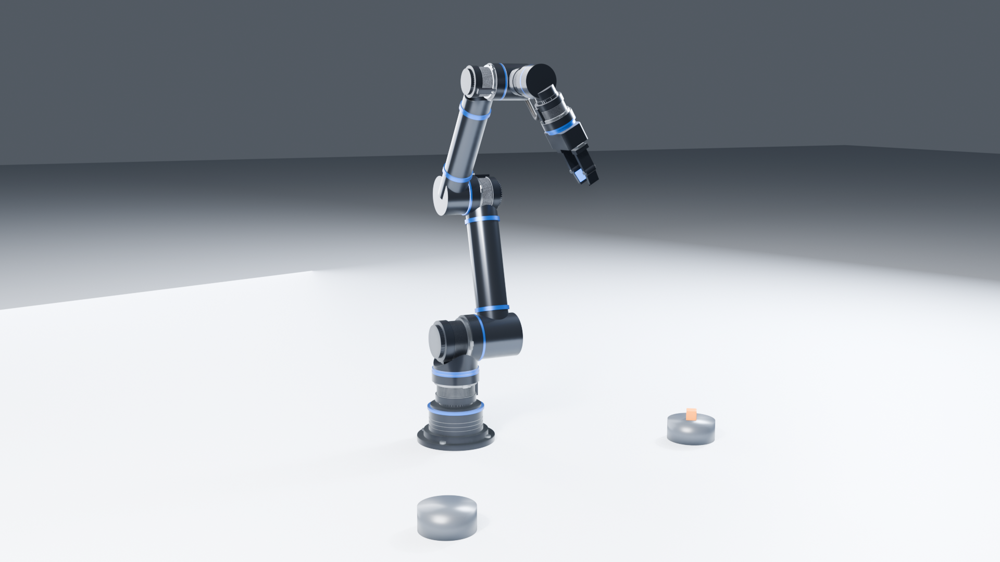

# Robot arm: six-axis arm with claw gripper



The reference is a back print on a press3 tee: a collaborative-style robot arm with a stepped pedestal,
long tubular links, a three-joint wrist with a loose service cable, and a two-finger claw. This project
reads it as a **six-axis arm built from one family of joint actuators**: the same rotary module as
[`unknown-machine/`](../unknown-machine/) (finned motor can, clamp band, blue bolt ring, recessed
output), used at six sizes from the base to the tool. Each link and the gripper are modelled as separate
components, and the joints, poses and a pick-and-place animation are defined so the arm can be moved and
checked.

| Home pose | Picking |
|---|---|
|  |  |
|  |  |

**Motion:** [`images/walkaround.mp4`](images/walkaround.mp4) (17 s, 1080p). The arm picks a block from
one stand, places it on another, does a wrist flourish and returns home, while the camera circles once.

## Layout

Zero pose: upper arm vertical, forearm along +X, gripper pointing down.

| Joint | Axis | Pivot (mm) | Limits | Actuator (OD × L, mm) |
|---|---|---|---|---|
| J1 base | Z | (0, 0, 0) | ±180° | 140 × 100 |
| J2 shoulder | Y | (0, 0, 300) | ±110° | 140 × 130 |
| J3 elbow | Y | (0, 0, 725) | −160° to +30° | 120 × 110 |
| J4 wrist pitch | Y | (400, 0, 725) | ±180° | 100 × 100 |
| J5 wrist yaw | X | (·, 127, 725) | ±180° | 90 × 90 |
| J6 tool roll | Z | (556, 127, ·) | ±360° | 90 × 85 |
| Grip (2 coupled sliders) | ±X | — | 0–30 mm per finger | — |

- Upper arm 425 mm, forearm 400 mm; reach about 0.98 m.
- Mass about 24.7 kg: actuators 13.2 kg, structure 11.5 kg. The arm tubes are hollow (5 mm and 4 mm walls).

## Materials

| Part | Material | Finish |
|---|---|---|
| Pedestal, turret | Al 6061-T6 (cast A356 would be the production choice) | black powder coat |
| Upper arm and forearm tubes, wrist knuckles | Al 6061-T6 | gunmetal hard anodize |
| Accent rings, tool flange | Al 6061-T6 | blue anodize |
| Actuator housings | Al 6061-T6 | black anodize |
| Actuator outputs, clamp bands, screws, rail, pins | Stainless 304 | brushed / polished |
| Gripper body, fingers | Al 7075-T6 | black anodize |
| Grip pads | TPU 60A | — |
| Cable jacket | TPU 98A | — |

## Files

```
images/                    reference, 1080p renders, walkaround.mp4
source/steve/arm/          STEVE design: main.py, params.py, shapes.py, motion.py, checks.py, components/*.py
source/steve/actuator/     STEVE part: the joint actuator (diameter, length, pedestal, fin_count)
source/blender/            render_arm.py (stills + walk-around) and the animated scene
exports/step/              robot-arm-assembly.step, components/*.step, joint-actuator-with-foot.step
exports/stl/arm/           one STL per body + manifest.json (materials, masses, design frame, zero pose)
exports/stl/actuator/      the standalone actuator with its foot mount
```

The CAD source is CadQuery 2.8 using STEVE's `Model` / `Component` / `Design` API. In `main.py`,
`links.actuator` is STEVE's link to the actuator part; see [`source/steve/arm/links.md`](source/steve/arm/links.md).
`motion.py` holds the joints, poses and the 15.5 s `pick_and_place` animation, and `checks.py` holds the fit
and collision checks.

To re-render, run from this folder (Blender 4.5):

```
blender -b -P source/blender/render_arm.py -- exports/stl/arm renders
```

## Tests

STEVE stress, vibration, fit and collision results are in [`TESTS.md`](TESTS.md). In short:

- Every link is more than 25× below yield, carrying a 3 kg payload with the arm stretched out level.
  Upper-arm deflection is 0.08 mm.
- The upper arm on its own has its first natural frequency at 488 Hz (hand check: 499 Hz).
- The fit check found four interferences between links and actuators, now fixed.
- The elbow limit was cut to +30°, after the collision studies showed the wrist folding into the shoulder.
- With J4 at about +90° to +130°, the gripper can still reach back into the upper arm: that's left for a
  software keep-out zone.

## Caveats

This is a visual reverse-engineering, not a production design. It has no gearbox internals, bearings
or torque sizing; the actuators are exterior shells. The stress checks in `TESTS.md` are linear-static
estimates of the links only. The renders and video were made before the revision 5 fit fixes, which
changed parts by a few millimetres.
