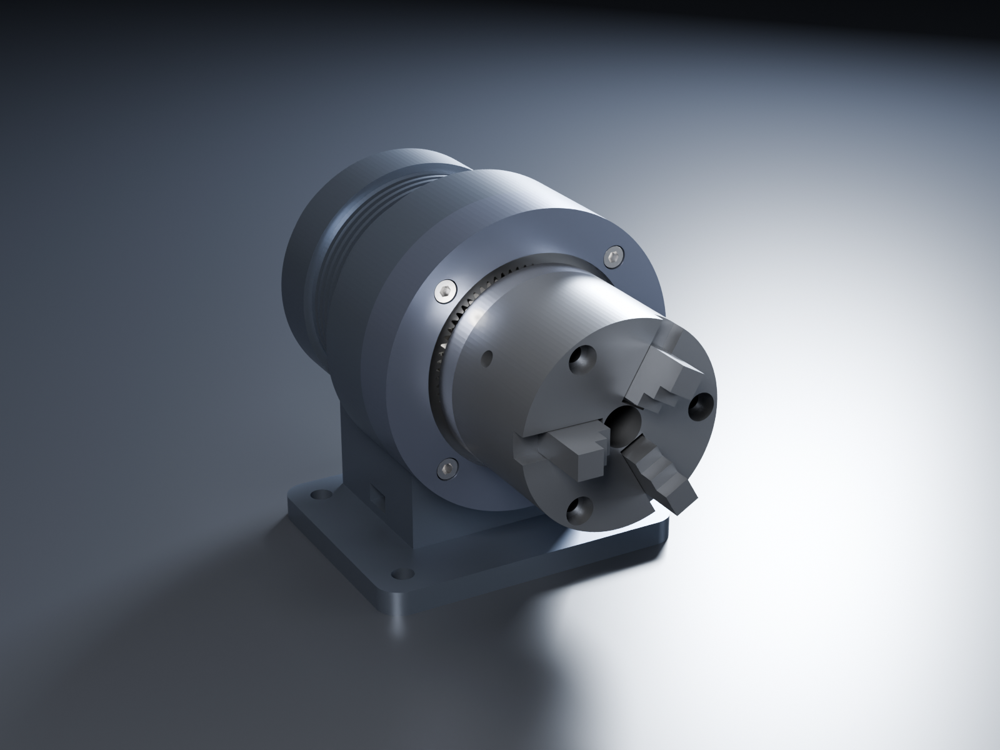

# Unknown machine: planetary joint actuator


An AI image generator produced this "machine" with no stated purpose. The project reads its outside features
as a design intent, then fills in the parts that would have to be inside for it to work. Our conclusion is
that it's a **robot-joint actuator**: a frameless brushless motor driving a single-stage planetary gearbox,
with a hollow shaft for cables, an encoder on the back, and a quick-release clamp that holds it on a
pedestal mount. (The clamp was later replaced by screws: see [Pedestal mount](#pedestal-mount).) Similar renders in the same series show robot arms, so this is most likely one of an arm's
joint modules shown standing on its own.

| Assembled | Inside (housing, flange and ring gear hidden) |
|---|---|
|  |  |

## Reading the image

| In the image | Interpreted as | Modelled |
|---|---|---|
| Finned middle section | Motor housing with cooling fins | Kollmorgen KBM-17 frameless stator (10-pole) and rotor on a hollow shaft |
| Fine-toothed ring around the front disk | Fixed **ring gear** of a planetary stage | Sun 18 T, 3 planets 27 T, ring 72 T, module 1: **5:1 reduction** |
| Silver disk + small hub with a bore | Planet carrier = output, with a hollow cable pass-through | Two-piece carrier: rear part with 3 bridge posts + bolted front disk and hub, 3 pressed-in planet pins, 8 mm bore end to end |
| Knurled rear cap | Encoder cover | Code disk on the shaft + read head on the end bell |
| Bolted front flange | Retains the ring gear | 4 × M5×30 socket head screws into tapped holes in the housing (14.5 mm of thread) |
| Top lever + silver band | Quick-release cam clamp | Modelled first as a band and lever; **removed**: it did no useful work. The housing now bolts to the pedestal. |
| Base with 4 holes, side port | Mounting pedestal with cable exit | Saddle block the housing bolts into + base plate with four Ø9 holes |

## Main numbers

- Envelope about 130 × 162 × 137 mm (flange Ø120 mm, motor can Ø96–120 mm)
- Gear ratio 1 + 72/18 = **5:1**; planets evenly spaced ((18 + 72) is divisible by 3) and phased to mesh
- Bearings: a CRBH 3510 crossed-roller bearing (35 × 60 × 10) carries the output and the arm's tilting
  moment; 6001-2RS (12 × 28 × 8) at the rear; HK1210 needle bearing pilots the shaft's front end inside the
  carrier; each planet runs on an HK0609 needle bearing (6 × 10 × 9)
- Through-bore: 8 mm from the rear cap to the output hub

## Parts list

Bought-in parts use real catalogue STEP models where an exact match exists. They come from
[step.parts](https://www.step.parts), an open-source (MIT) catalogue. The rest are modelled at catalogue
dimensions.

| Qty | Part | Material (modelled) | Source |
|---|---|---|---|
| 1 | Motor housing | 6061-T6 aluminium, anodised | made |
| 1 | Rear end bell | 6061-T6 aluminium, anodised | made |
| 1 | Encoder cap (knurled) | 6061-T6 aluminium, anodised | made |
| 1 | Encoder disk | 304 stainless | made |
| 1 | Encoder read head | PC | bought (placeholder shape) |
| 1 | Rear bearing **6001-2RS** (12 × 28 × 8) | bearing steel (C60 stand-in) | **catalogue STEP**: [step.parts `bearing_6001_2rs_sealed_simple`](https://www.step.parts/parts/bearing_6001_2rs_sealed_simple) |
| 1 | Stator **Kollmorgen KBM-17H01-B00** | (envelope model) | bought with the rotor as a kit |
| 1 | Rotor **Kollmorgen KBM-17H01-B00** (bonded to the hub sleeve) | (envelope model) | bought with the stator as a kit |
| 1 | Motor shaft + rotor hub sleeve | steel | made |
| 1 | Sun gear, m1 18T | 18CrNiMo7-6 (17CrNiMo6) case-hardening steel, carburised | made |
| 3 | Planet gear, m1 27T | 18CrNiMo7-6 (17CrNiMo6) case-hardening steel, carburised | made |
| 1 | Ring gear, m1 72T internal | 34CrNiMo6, quenched and tempered (nitriding optional) | made |
| 1 | Planet carrier, rear part (sleeve, rear plate, 3 posts) | 303 stainless (304 stand-in in the model) | made |
| 1 | Planet carrier, front disk + output hub | 303 stainless (304 stand-in in the model) | made |
| 3 | Countersunk socket screw **ISO 10642 M4 × 12** (front disk to posts) | A2-70 stainless | **catalogue STEP**: [step.parts `countersunk_socket_screw_m4_l0012_simple`](https://www.step.parts/parts/countersunk_socket_screw_m4_l0012_simple) |
| 3 | Planet pin, dowel **ISO 2338 6 m6 × 18** | hardened steel | bought, modelled at catalogue size* |
| 3 | Planet needle bearing **HK0609** (6 × 10 × 9), drawn cup | bearing steel | bought, modelled at catalogue size* |
| 1 | Pilot needle bearing **HK1210** (12 × 16 × 10) | bearing steel | bought, modelled at catalogue size* |
| 1 | Output bearing **CRBH 3510** crossed roller (35 × 60 × 10) | bearing steel | bought, modelled at catalogue size* |
| 1 | Front flange | 6061-T6 aluminium, anodised | made |
| 4 | Socket head cap screw **ISO 4762 M5 × 30** (flange) | A2-70 stainless | **catalogue STEP**: [step.parts `iso4762_socket_head_cap_screw_m5x30`](https://www.step.parts/parts/iso4762_socket_head_cap_screw_m5x30) |
| 1 | Pedestal (saddle bored Ø120 / Ø96 to the housing, 4 counterbores from below, 2 dowel holes) | 6061-T6 aluminium, anodised | made |
| 4 | Socket head cap screw **ISO 4762 M5 × 20** (pedestal to housing, from below) | A2-70 stainless | **catalogue STEP**: [step.parts `iso4762_socket_head_cap_screw_m5x20`](https://www.step.parts/parts/iso4762_socket_head_cap_screw_m5x20) |
| 2 | Dowel pin **ISO 2338 4 m6 × 12** (locates the housing in the saddle) | hardened steel | bought, modelled at catalogue size* |
| 1 | Thermal pad or paste between housing and saddle (e.g. 0.25 mm silicone pad) | — | bought |

\* No exact catalogue model was available, so these are modelled at the standard's dimensions:

- **CRBH 3510, HK0609 and HK1210:** step.parts has none of these. The crossed-roller bearing is a simplified
  model (two rings and 28 crossed rollers); check the final choice against the maker's drawing.
- **ISO 2338 dowel pins:** step.parts lists them, but its files are twice their nominal length (its "6 × 16"
  measures 32 mm), so they weren't used.
- **Gears:** the catalogue only has small module 0.5 gears, 4 mm wide. Nothing matches module 1 / 12 mm
  wide, and internal ring gears are rarely sold off the shelf.

Swapping in the catalogue parts also changed the carrier. With separate pressed-in pins, nothing joined its
two plates any more, so it gained three bridge posts between the planets (2 mm clear of the planet tips).
It is now made as two pieces, the rear part with the posts and a bolted front disk, so it can be machined from
the open front face; see [the analysis](analysis/README.md#two-piece-carrier-in-303).

## Files

```
images/
  reference.png              the AI-generated image this started from
  assembled-isometric.png    render of the model (Blender, from STEVE's mesh export)
  internals-isometric.png    render with the outer parts hidden
  render_blender.py          the render script: studio lights, metal materials, geometry unchanged
source/                      CadQuery source for the STEVE CAD design
  main.py                    places the parts, joints, gear coupling, teardown animation, fit check
  params.py                  gear module and tooth counts
  assembly_data.py           teardown order, flange screw pattern
  gearing.py                 involute spur and internal gear profiles
  shapes.py                  small geometry helpers (rings, boxes, ball bearings)
  components/*.py            one file per part (catalogue parts import their step.parts STEP by sha256)
  parts/carrier.py           planet carrier rear part, a separate part linked into the design (`from links import carrier`)
  parts/carrier_disk.py      planet carrier front disk and output hub, likewise (`from links import carrier_disk`)
  parts/pedestal.py          pedestal, likewise
  parts/chuck_backplate.py   optional lathe chuck backplate (303), a separate STEVE part
analysis/
  README.md                  stress / strain results (FEA and hand calculations) and what they mean
  hand_calcs.py              gear, pin, bolt and bearing checks; plain Python 3
  motor_curves.py            output torque / power vs speed (chart, CSV, animated chart)
  motor-showcase.mp4         32 s video: Gravity particle sim of the envelope, then the chart
  gravity/                   the Gravity sim module, its render and the script that joins the video
exports/
  step/unknown-machine-assembly.step   full assembly, every part in place
  step/components/*.step               one STEP per part, as modelled (catalogue parts at their own origin)
  stl/*.stl                            one STL mesh per part type, mm, in its assembled position (design frame)
```

The STL files all sit where the part goes in the assembly; for parts used several times (planets, pins,
screws, dowels) the file is the first one. In `step/components`, made parts sit at their assembled position
and the catalogue parts (bearing, screws) at their own origin; `source/main.py` places them.

There are no DXF files because nothing in this design is sheet metal or laser-cut flat stock.

### Motion in the source

- `spin`: the motor turns the sun, planets and carrier at the correct planetary ratios.
- `teardown` animation: takes the unit apart in the service order, checked for collisions on every build:
  1. The flange screws come out, then the flange comes off with the ring gear pressed into it, and the ring is
     pressed out forward.
  2. The encoder cap, encoder disk and end bell with its bearing come off the back.
  3. The carrier and planets come out the front, taking the sun with them. The sun is caught between the
     carrier's rear plate and front disk, so it slides off the shaft's key.
  4. The output bearing comes out the front, then the rotor and the stator come out the back.
  5. The four pedestal screws come out from below and the unit lifts off the pedestal.
- `exploded` pose: every part pulled apart along the axis.
- `showreel` animation (STEVE branch `showreel` only): 20 s on a display turntable for showing people. The
  table turns once, the motor turns 10 times, and the unit comes apart front and back at once and goes back
  together. It is checked for collisions (`check=True`), which caught three real order constraints. The ring
  gear is pressed into the flange, so they come off together. The sun is caught inside the carrier, so it
  slides off the shaft and comes out with the carrier before the rotor goes out the back. The encoder disk
  rides on the rotor. The `teardown` on main now follows the same order. To make the video, open the
  branch in STEVE, then use Motion tab → `showreel` → export (STEVE's MCP can't export video yet; a feature
  request is filed).
- A fit check (interference between all 378 part pairs, with declared seats, gear meshes and screw threads)
  passes on this revision.

Frame: the motor axis is +Z with the output at +Z, and the pedestal points toward −Y.

## Stress and strain

Summary of [analysis/README.md](analysis/README.md), at an assumed 20 N·m peak output torque. Everything
below was solved in STEVE.

- **Planet carrier:** now two pieces (rear part + bolted front disk). At 20 N·m, with each piece taking the
  whole load in turn, the peaks are 21.6 MPa (rear part) and 16.2 MPa (front disk), at least 10× below yield.
  The one-piece carrier peaked at 12.5 MPa, 0.37 µm deflection, about 65 µε strain.
  Under a 150 N overhung arm load it deflects 5.3 µm.
- **Gear teeth (bending):** the sun tooth root reaches 143 MPa (planet 109, ring 68). That is a factor of
  about 1.6 on the soft S235 used in the model, so the gears need gear steel. Contact stress at the sun
  (657 MPa, from the hand calculation) says the same: **case-hardened gears**.
- **Planet pins:** about 50 MPa, roughly 20× below yield. Plain planet journals would run too hot (PV
  2.4 MPa·m/s at 3000 rpm), so each planet now runs on an HK0609 needle bearing.
- **Motor housing** (KBM bore, crossed-roller bulkhead, bolted to the pedestal): 8.4 MPa under the torque
  and bearing loads when held by the four pedestal screws alone. Thermally, bolting it into the pedestal is
  what makes the difference. At 40 W of continuous losses in still air it reaches **about 73 °C** with the
  pedestal on an insulating surface (was 88 °C on the clamp band), and **about 44 °C** with the pedestal
  bolted to a metal structure at 35 °C.
- **Pedestal mount:** four M5 screws hold 7.2× the output torque by friction, with dowels behind them. The
  housing on its pedestal has a first mode of 1.75 kHz (structure only, no internal parts).
- **Screw threads:** every screw joint is declared in STEVE and checked on each build. Thread engagement is
  at least 2.2 d everywhere: front flange M5 × 30 14.5 mm, pedestal M5 × 20 11 mm, carrier M4 × 16 11 mm.
- **Clamp lever** (since removed): 155 MPa at a 100 N push with the original 6 mm deep side bars.
- **Vibration:** every part's first natural frequency is above 3.4 kHz, against a 720 Hz gear-mesh
  frequency at 3000 rpm.
- **Flange screws:** hold 7.5× the ring-gear reaction by friction (hand calculation).

## Motor: Kollmorgen KBM-17H01-B00

The motor is a **Kollmorgen KBM-17H01-B00** frameless brushless kit (stator + rotor, made in the US), chosen
with the part selector (`python3 ../tools/partsel/partsel.py requirements/motor.toml --detail`) against the
requirements in [`requirements/motor.toml`](requirements/motor.toml). It runs from a **240 Vac servo drive
(about 325 V DC bus)** rather than 48 V: no standard KBM winding reaches 3000 rpm on 48 V.

| | KBM-17H01-B00 (catalog) | Requirement |
|---|---|---|
| Stator OD × length | 84.963 × 57.80 mm | ≤ 86 mm OD, ≤ 70 mm long |
| Rotor bore × length | 30.010 × 30.15 mm | passes the 12 mm hollow shaft |
| Continuous / peak torque | 2.06 / 6.14 N·m | ≥ 1.3 / ≥ 4 N·m |
| Bus needed at 3000 rpm | 201 V DC (derived from Kb 41.2 Vrms/kRPM) | ≤ 325 V DC |
| Current at 4 N·m / continuous | 5.9 A / 3.11 A rms | sizes the drive |
| Winding rating, sensor | 155 °C, PTC thermistor | ≥ 150 °C, a sensor |
| Mass | 1.05 kg | |

Selector result: B and C windings pass; the A winding needs 379 V DC at 3000 rpm and fails; the longer
KBM-17H02 fails on length; the TQ ILM 85x13 can't be confirmed (temperature rating and sensor not published on
its product page) and isn't American. B was picked over C for half the current (a smaller drive).

**Fit in the housing.** The KBM stator is longer than the old stand-in but fits the same housing: it uses the
13 mm that was free ahead of the old windings. Per Kollmorgen's mounting guide (catalog pp. 90–95):

- The housing bore is now Ø85.10 (0.07 mm slip fit per side) from the rear, so the stator slides in from the
  back and **bonds in** (3M Scotchweld 2214 or Hysol EA934NA; machine shallow adhesive grooves, 0.13–0.26 mm
  deep, over at least half the bore).
- A 2 mm **depth-stop ledge** (Ø81 bore) at the front locates it; the stator's front sits 2 mm off the bulkhead
  floor, Kollmorgen's minimum end-turn clearance.
- The rotor bonds onto a Ø30 hub sleeve on the shaft and banks against a Ø34 shoulder (below the magnet
  diameter). Don't cure the rotor bond above 82 °C unless it's inside the stator.
- Kollmorgen can add 8 × M3 tapped holes on a 23.5 mm circle to the rotor if a bolted rotor is preferred.

**Still to confirm from Kollmorgen's 3D model** (kollmorgen.com/kbm; the catalog doesn't give them): the stator
bore and end-turn diameter (the ledge must clear the end turns by 2 mm) and the rotor OD. The model uses
estimates (stator bore 52 mm, rotor OD 50 mm), marked in `stator.py` and `motor_rotor.py`. Download the STEP and
it can replace the envelope parts.

**Limit the drive's peak current to about 5.9 A.** At its full 6.14 N·m the motor would put 31 N·m through the
gears, which are sized for 20 N·m.

## Lathe option



The actuator can also be a small lathe headstock. A 303 backplate bolts to the output disk (6 × M4 × 12, piloted
on the Ø20 hub) and takes a bought 80 mm front-mount 3-jaw chuck. In STEVE it's the
[backplate part](https://stevecad.studio/?document=b55f2ff3-a103-4a53-9ea2-28fac9591a3e) and the actuator's
`lathe` branch, where the fit check (1,081 pairs) and the teardown check (chuck off first) both pass. The whole
manual lathe, with bed, slides, tool post, tailstock and dials, is in [`lathe-kit/`](../lathe-kit/).

## Pedestal mount

The image shows a stainless band with a lever, read at first as a quick-release cam clamp. It was modelled
that way and then removed. It did no useful work: a joint module bolted into an arm doesn't need tool-free
removal. It also caused two problems. The stainless band around the aluminium housing was the source of the
thermal stress, and the band and saddle gave the motor heat almost no path into the pedestal.

The housing now sits straight in the pedestal saddle:

- **Saddle:** bored to the housing, Ø120 under the front section and Ø96 under the fins. The saddle block runs
  from z −20 to 44, so the finned section is supported too. Bore it +0.00/+0.03 mm and fit a thin thermal pad
  or paste in the joint.
- **Screws:** 4 × ISO 4762 M5 × 20 (A2-70) come up from below, through counterbores in the base, into M5
  holes in the housing's front section and bulkhead (x ±16, z 28 and 37). The housing is round, so at x ±16
  its surface is at y −57.8: the screws reach y −46, about 11 mm (2.2 d) of thread, and each blind hole stops
  4.1 mm short of the stator bore. Friction alone holds 144 N·m about the axis, 7.2× the output torque.
- **Dowels:** 2 × ISO 2338 4 m6 × 12 on the centre line (z 22 and 40), pressed into the pedestal. The housing
  goes back in the same place after every removal, which also helps test fits at the machine shop.
- **Access:** the screws are reached from under the base, so take the actuator off before bolting the
  pedestal down, or unbolt the pedestal first. If it must come off with the pedestal in place, side ears with
  screws from above are the alternative.

| STEVE study (housing on pedestal, 40 W, still air, 25 °C) | Result |
|---|---|
| Base on an insulating surface | **69–73 °C** (was 88 °C on the clamp band) |
| Base bolted to a metal structure held at 35 °C | **35–44 °C**; 28 of the 40 W leave through the base |
| Housing held by the 4 screws alone: ring reaction + bearing loads | 8.4 MPa, 6.6 µm |
| First natural frequency, base bolted down, no internal parts | **1.75 kHz** (1.82 kHz with the Ø112 front, 1.33 kHz before the saddle block was lengthened) |

See [analysis](analysis/README.md#pedestal-mount-clamp-removed) for how these were set up and what they
leave out.

**What it delivers:** 18.3 N·m at the output up to 910 rpm (1.74 kW peak) on the 5.9 A drive limit, 10.3 N·m
continuous, 1060 rpm no-load. See the [torque-speed chart](analysis/motor-curves.png) and the 32 s
[showcase video](analysis/motor-showcase.mp4): a Gravity particle sim of 27,000 actuators, then the chart.

## Screw threads

The front of the housing grew from Ø112 to Ø120 (the flange's diameter) so the threads could be made
conservative rather than just adequate. Every screw joint is declared in STEVE (`design.fasten`) with the
engagement rule set to 2 d, and checked on the geometry at every build:

| Joint | Screw | Thread engagement | Wall around the thread | STEVE check |
|---|---|---|---|---|
| Front flange → housing | 4 × ISO 4762 M5 × 30 (was M5 × 25) | 14.5 mm = 2.9 d (was 9.5) | 7.9 mm to the OD (was about 3.5) | engagement, depth and walls pass; flagged "moving" (below) |
| Pedestal → housing, from below | 4 × ISO 4762 M5 × 20 | 11.0 mm = 2.2 d (was 9.0) | 4.1 mm to the stator bore | engagement and depth pass; flagged "moving" and saddle-exit wall (below) |
| Carrier front disk → posts | 3 × ISO 10642 M4 × 16 (was M4 × 12) | 11 mm = 2.75 d (was 7) | 4.35 mm in the post | **pass** |

The check still lists two things that aren't defects. Every screw holding a part that the teardown animation
slides away is marked "moving", although the teardown removes the screws first. And where the pedestal's
clearance holes exit through the curved saddle, the wall reads 0.00 mm wherever the hole is put. Both are
filed with STEVE as part of the video-export feature request. The pedestal changed to match: the saddle is
bored Ø120, the counterbore floor is at y −66, the screw rows moved to z 28 / 37 (2.25 mm of wall to the
block end; it was 0.25 mm) and the side cable port moved 2 mm toward the fins.

## Caveats

- This is an **interpretation**, not a reconstruction. The image doesn't fully commit to any one mechanism.
  A strain-wave (harmonic) drive fits about as well as the planetary stage chosen here. The planetary
  version was chosen because its ring-gear teeth show around the output disk, as in the image.
- The rear bearing and the flange screws are catalogue CAD models. The other bought parts are simplified
  shapes at catalogue dimensions, and the magnets are a steel stand-in.
- Gears have zero backlash. The motor torque behind the [stress analysis](analysis/README.md) is assumed,
  not taken from a datasheet.
- The analysis found weak points that have since been fixed in the model: case-hardened gear steel, planet
  needle bearings, a crossed-roller output bearing, a Kollmorgen KBM-17 motor (see
  [Motor](#motor-kollmorgen-kbm-17h01-b00)) and a bolted pedestal mount with a heat path in place of the clamp
  (see [Pedestal mount](#pedestal-mount)) and conservative screw threads (see [Screw threads](#screw-threads)).
  Still open: a fillet at the carrier's sleeve-to-plate corner, and the KBM stator bore and end turns from
  Kollmorgen's 3D model (behind a free account login).
- The STEVE assembly (design revision 36) builds and passes its fit check (741 part pairs, nothing new or
  worse) with all these changes. `exports/` and the two renders above are from that revision: the assembly STEP,
  one STEP per component, and one STL per part type in its assembled position (design frame, mm).
- The gears in the assembly source still have sharp tooth roots. The separate STEVE gear parts used for the
  stress studies add the standard 0.38 mm root fillet.
- Provided under the repository's [MIT license](../LICENSE), without warranty of any kind.
