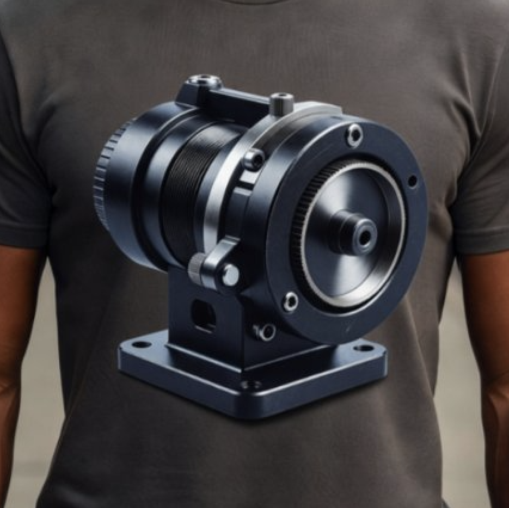
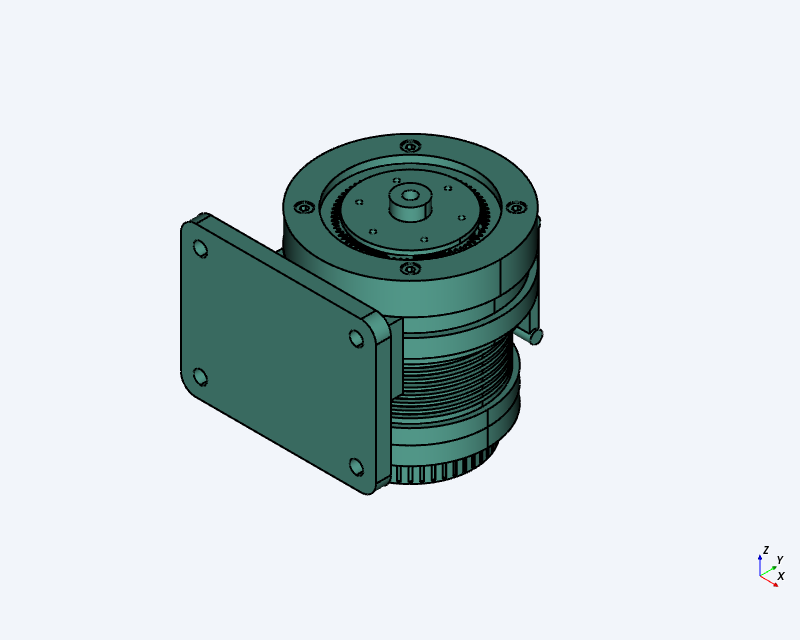
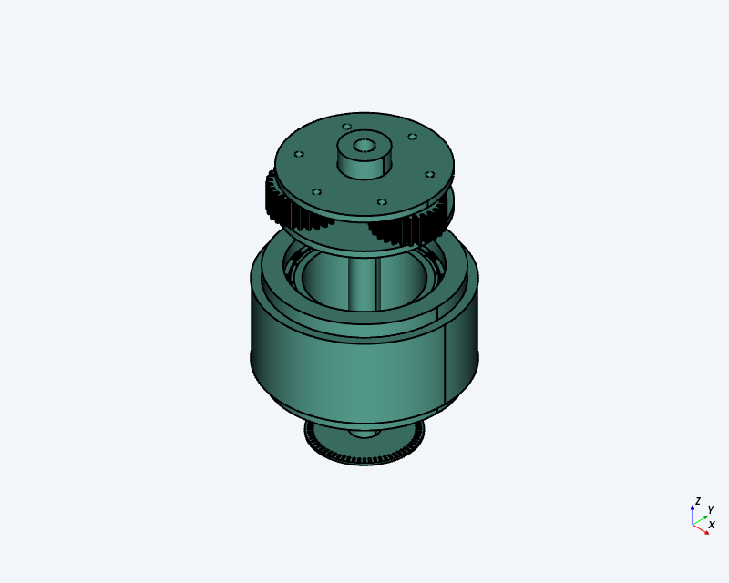

# Unknown machine: planetary joint actuator



An AI image generator produced this "machine" with no stated purpose. The project reads its outside features
as a design intent, then fills in the parts that would have to be inside for it to work. Our conclusion is
that it's a **robot-joint actuator**: a frameless brushless motor driving a single-stage planetary gearbox,
with a hollow shaft for cables, an encoder on the back, and a quick-release clamp that holds it on a
pedestal mount. Similar renders in the same series show robot arms, so this is most likely one of an arm's
joint modules shown standing on its own.

| Assembled | Inside (housing, flange and ring gear hidden) |
|---|---|
|  |  |

## Reading the image

| In the image | Interpreted as | Modelled |
|---|---|---|
| Finned middle section | Motor housing with cooling fins | 12-slot stator, copper windings, 14-pole surface-magnet rotor |
| Fine-toothed ring around the front disk | Fixed **ring gear** of a planetary stage | Sun 18 T, 3 planets 27 T, ring 72 T, module 1: **5:1 reduction** |
| Silver disk + small hub with a bore | Planet carrier = output, with a hollow cable pass-through | Two-plate carrier with 3 pins, 8 mm bore end to end |
| Knurled rear cap | Encoder cover | Code disk on the shaft + read head on the end bell |
| Bolted front flange | Retains the ring gear | 4 × M5×25 socket head screws into tapped holes in the housing |
| Top lever + silver band | Quick-release cam clamp | Band around the housing, lever pivoting on a pin |
| Base with 4 holes, side port | Mounting pedestal with cable exit | Saddle block + base plate with four Ø9 holes |

## Main numbers

- Envelope about 130 × 162 × 137 mm (flange Ø120 mm, motor can Ø96–112 mm)
- Gear ratio 1 + 72/18 = **5:1**; planets evenly spaced ((18 + 72) is divisible by 3) and phased to mesh
- Bearings: 61806 (30 × 42 × 7) carries the output, 6001 (12 × 28 × 8) at the rear, HK1210 needle bearing
  pilots the shaft's front end inside the carrier
- Through-bore: 8 mm from the rear cap to the output hub

## Parts list

| Qty | Part | Material (modelled) |
|---|---|---|
| 1 | Motor housing | 6061-T6 aluminium, anodised |
| 1 | Rear end bell | 6061-T6 aluminium, anodised |
| 1 | Encoder cap (knurled) | 6061-T6 aluminium, anodised |
| 1 | Encoder disk | 304 stainless |
| 1 | Encoder read head | PC |
| 1 | Rear bearing 6001 | bearing steel (C60 stand-in) |
| 1 | Stator core | steel (lamination stack stand-in) |
| 1 | Windings | C10200 copper |
| 1 | Rotor + hollow shaft + magnets | steel (magnets: NdFeB, steel stand-in) |
| 1 | Sun gear | steel |
| 3 | Planet gear | steel |
| 1 | Ring gear | steel |
| 1 | Planet carrier (output) | 304 stainless |
| 1 | Pilot needle bearing HK1210 | bearing steel (C60 stand-in) |
| 1 | Output bearing 61806 | bearing steel (C60 stand-in) |
| 1 | Front flange | 6061-T6 aluminium, anodised |
| 4 | M5×25 socket head cap screw (ISO 4762) | 304 stainless |
| 1 | Clamp band | 304 stainless |
| 1 | Clamp lever | 6061-T6 aluminium, anodised |
| 1 | Pedestal | 6061-T6 aluminium, anodised |

## Files

```
images/
  reference.png              the AI-generated image this started from
  assembled-isometric.png    render of the model
  internals-isometric.png    render with the outer parts hidden
source/                      CadQuery source for the STEVE CAD design
  main.py                    places the parts, joints, gear coupling, teardown animation, fit check
  params.py                  gear module and tooth counts
  assembly_data.py           teardown order, flange screw pattern
  gearing.py                 involute spur and internal gear profiles
  shapes.py                  small geometry helpers (rings, boxes, ball bearings)
  components/*.py            one file per part
exports/
  step/unknown-machine-assembly.step   full assembly, every part in place
  step/components/*.step               one STEP per part
  stl/*.stl                            one STL mesh per part, mm, made from the STEP files
```

Part files sit at their assembled position, except `planet` and `flange_screw`. Those are modelled once at
their own origin and placed 3× and 4× by `source/main.py`.

There are no DXF files because nothing in this design is sheet metal or laser-cut flat stock.

### Motion in the source

- `spin`: the motor turns the sun, planets and carrier at the correct planetary ratios.
- `teardown` animation (about 14 s): takes the unit apart in a service order. The lever opens, then the
  screws, flange, carrier with planets, ring gear and output bearing come out of the front. The band, encoder
  cap, encoder disk and end bell with its bearing come off the back, then the rotor and stator come out and
  the unit lifts off the pedestal.
- `exploded` pose: every part pulled apart along the axis.
- A fit check (interference between all 300 part pairs, with declared seats, gear meshes and screw threads)
  passes on this revision.

Frame: the motor axis is +Z with the output at +Z, and the pedestal points toward −Y.

## Caveats

- This is an **interpretation**, not a reconstruction. The image doesn't fully commit to any one mechanism.
  A strain-wave (harmonic) drive fits about as well as the planetary stage chosen here. The planetary
  version was chosen because its ring-gear teeth show around the output disk, as in the image.
- Bearings, screws and magnets are simplified shapes at catalogue dimensions, not supplier CAD models.
- Gears have zero backlash and no tooth-strength or motor sizing has been done. Geometry alone says nothing
  about load capacity.
- Provided under the repository's [MIT license](../LICENSE), without warranty of any kind.
